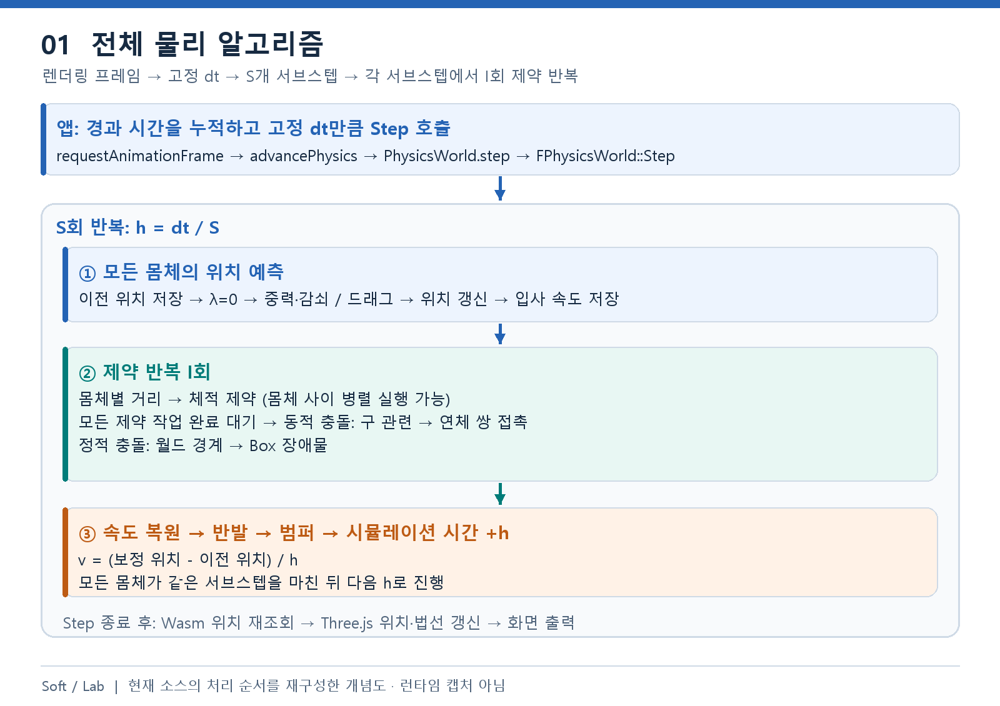
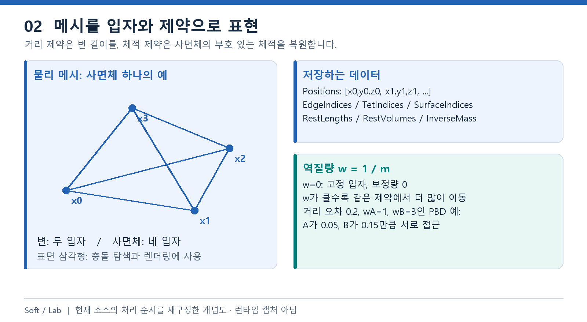
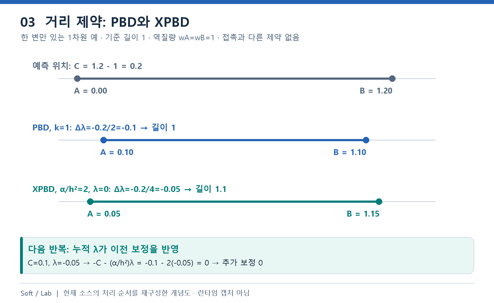
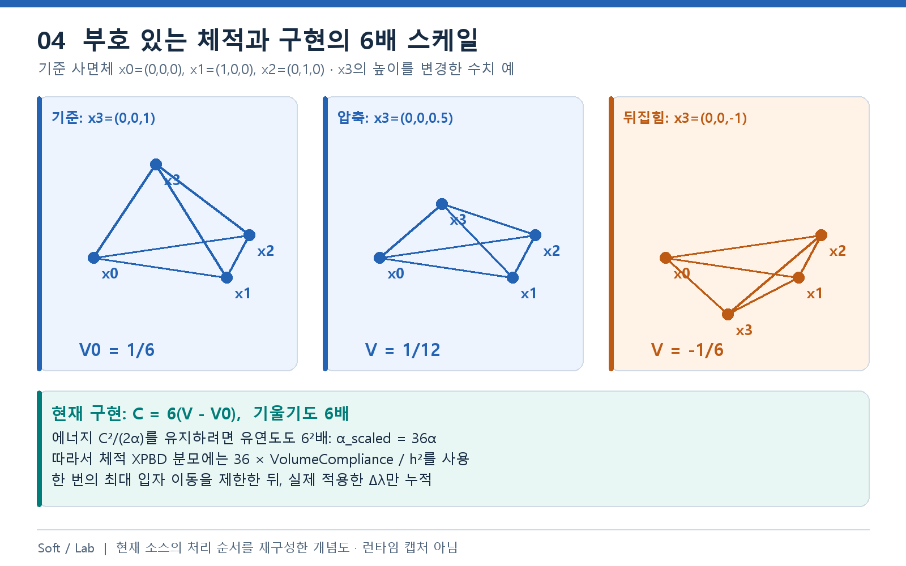
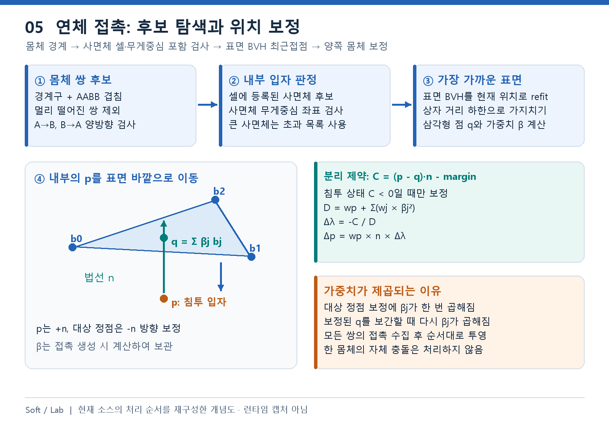
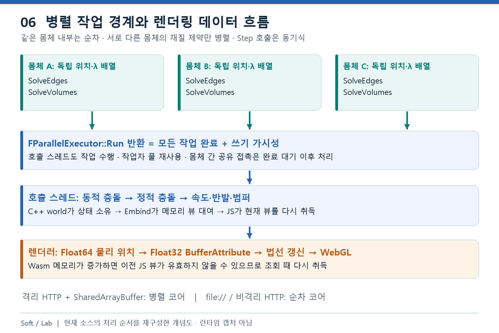

# Soft / Lab — C++20 PBD · XPBD

[웹 실행](https://pbd-softbody-lab-20261108.true-orbit-7047.chatgpt.site) · [GitHub](https://github.com/sh0717/pbd_softbody_simulation) · [실행용 ZIP](https://pbd-softbody-lab-20261108.true-orbit-7047.chatgpt.site/pbd-softbody-simulation.zip)

테트라 메시의 연체와 구를 Box 장애물과 함께 실험하는 브라우저 시뮬레이션입니다.
C++20이 물리 상태·제약·접촉을 계산하고, WebAssembly를 통해 JavaScript·Three.js가 입력과 화면을 담당합니다.

## 바로 실행

저장소를 다운로드하고 압축을 푼 뒤 **`index.html` 또는 `pbd_model.html`을 Chrome·Edge로 엽니다.**
`dist/`를 포함한 폴더 구조를 유지합니다. 배포 번들에 Wasm을 내장하므로 `file://`에서도 실행하며
Node.js·Python·별도 서버와 실행 중 CDN 연결은 필요하지 않습니다. WebGL 지원 브라우저가 필요합니다.

- 실행·일시정지, 초기화, PBD/XPBD 전환과 시간 간격·서브스텝·제약 반복·재질을 조절합니다.
- 토끼·공·Box 장애물은 각각 최대 10개입니다. Box를 선택해 드래그하거나 위치·크기를 편집합니다.
- 범퍼를 켜면 접촉 진입 시 추가 충격을 줍니다. 초기화는 물체를 복원하고 편집한 장애물 배치를 유지합니다.

## 개발

Node.js 22.20.0 기준입니다. 웹 빌드는 저장소에 포함된 Wasm을 사용합니다.

```powershell
npm.cmd ci --ignore-scripts
npm.cmd run build
npm.cmd start
```

<http://127.0.0.1:4173/>을 엽니다. 서버는 `Ctrl+C`로 종료합니다.
`build`는 Three.js·OrbitControls 0.139.2를 로컬 배포 폴더로 복사하고 실행 HTML과 번들을 생성합니다.
C++을 수정했다면 Emscripten 4.0.23과 Python을 준비해 `npm.cmd run build:all`로 Wasm도 재빌드합니다.
SDK는 `EMSDK` 또는 `.tools/emsdk-main`에서 찾습니다.

| 명령                              | 범위                                                                    |
| --------------------------------- | ----------------------------------------------------------------------- |
| `npm.cmd run check`               | C++·JS 서식, 구조, 소스/Wasm 해시와 Node 회귀. clang-format 22.1.3 필요 |
| `npm.cmd run test:native`         | CMake·MSVC Debug 빌드와 CTest                                           |
| `npm.cmd run test:native:release` | 네이티브 Release 빌드와 CTest                                           |
| `npm.cmd run test:browser`        | Python·설치된 Chrome을 사용하는 UI·수명 검사                            |
| `npm.cmd run test:distribution`   | 배포 HTML의 HTTP·직접 파일 실행 검사                                    |
| `npm.cmd run check:execution`     | 전체 검사 결과와 현재 소스·배포물 해시 확인                             |
| `npm.cmd run verify`              | Wasm·웹 빌드, check, native Debug/Release, 브라우저 검사                |

검사 결과와 오류 로그는 GitHub Actions와 로컬 `artifacts/`에서 확인합니다.
`check:execution`은 `verify`가 생성한 검사 결과의 소스·배포물 해시와 종료 코드를 확인합니다.
CI 브라우저 검사는 `PBD_TEST_SOFTWARE_WEBGL=1`로 CPU 렌더러를 사용합니다.

## 전체 알고리즘

**입자의 위치를 먼저 예측하고, 거리·체적·접촉 조건에 맞게 위치를 보정한 뒤 속도를 복원합니다.**
아래 그림은 현재 C++ 구현을 설명하기 위해 재구성한 개념도이며 실행 화면 캡처가 아닙니다.
코드는 링크한 실제 구현에서 발췌하며, 일부 발췌에서는 주변 검증·반복문을 생략합니다.

[전체 흐름](#1-시간-진행과-전체-처리-순서) · [입자 모델](#2-메시와-입자-상태) ·
[PBD·XPBD](#3-pbd와-xpbd의-공통-보정식) · [거리](#4-거리-제약) ·
[체적](#5-부호-있는-체적-제약) · [충돌](#6-충돌-탐색과-접촉-제약) ·
[반발·범퍼](#7-속도-복원-반발과-범퍼) · [병렬·렌더링](#8-병렬-실행과-렌더링-연결)

### 1. 시간 진행과 전체 처리 순서



[src/app.js](src/app.js)의 `advancePhysics()`는 화면 경과 시간을 누적하고,
누적 시간이 설정한 고정 시간 간격 $\Delta t$ 이상이면 `world.step()`을 실행합니다.
프레임 경과 시간은 최대 0.1초, 따라잡기 실행은 프레임당 최대 6스텝으로 제한합니다.
한도를 넘은 완전한 스텝은 생략 횟수로 기록합니다. 따라서 화면 FPS와 물리 스텝 수는 다릅니다.

| 기호           | 의미                                     | 구현                  |
| -------------- | ---------------------------------------- | --------------------- |
| $\Delta t$     | 월드에 요청하는 한 스텝의 시간, 초       | `Dt`                  |
| $S$            | 한 스텝의 서브스텝 수                    | `Settings.Substeps`   |
| $h=\Delta t/S$ | 적분·XPBD가 함께 사용하는 시간 간격, 초  | `SubstepSeconds`      |
| $I$            | 각 서브스텝에서 위치 제약을 푸는 반복 수 | `Settings.Iterations` |

예를 들어 $\Delta t=1/60$, $S=4$, $I=3$이면 $h=1/240$초입니다.
한 스텝에서 예측·속도 복원은 각각 4회, 거리·체적·접촉 단계는 각각 12회 실행합니다.
서브스텝을 늘리면 중간 위치와 속도를 더 자주 갱신하고, 반복 수를 늘리면 같은 서브스텝의
예측 위치에서 제약을 더 여러 번 풉니다. 두 설정의 역할은 다릅니다.

[FPhysicsWorld::AdvanceSubstep](native/src/simulation/PhysicsWorld.cpp)의 처리 순서는 다음과 같습니다.

```text
Step(dt)
  h = dt / Substeps
  Substeps회 반복
    모든 몸체: 이전 위치 저장 → λ 초기화 → 위치 예측 → 입사 속도 저장
    Iterations회 반복
      연체별: 거리 제약 → 체적 제약
      모든 제약 작업의 완료 대기
      동적 충돌: 구-구 → 연체 입자-구 → 연체-연체
      모든 몸체: 월드 경계 → Box 장애물
    모든 몸체: 보정 위치로 속도 복원
    접촉 반발 → 범퍼 → 시뮬레이션 시간 += h
```

모든 몸체가 같은 $h$를 함께 진행합니다. `dt=0`은 진행하지 않으며, 잘못된 시간과
유연도 스케일은 [Settings](native/src/core/Settings.cpp)에서 검증합니다.

### 2. 메시와 입자 상태



[FSoftBody](native/src/simulation/SoftBody.cpp)는 입력 메시를 다음 상태로 구성합니다.
초기 변 길이와 **부호 있는 사면체 체적**을 계산하여 변형 후 복원할 기준으로 보관합니다.
물리 위치는 `double` 배열이며, 입자 $i$의 XYZ는 배열의 $3i,3i+1,3i+2$에 대응합니다.

| 데이터                                       | 역할                                                 |
| -------------------------------------------- | ---------------------------------------------------- |
| `Positions`, `PreviousPositions`             | 현재 예측·보정 위치와 서브스텝 시작 위치             |
| `Velocities`, `PreSolveVelocities`           | 작업 속도와 제약 적용 전 입사 속도 스냅샷            |
| `InverseMass`                                | $w_i=1/m_i$; $w_i=0$인 입자는 고정                   |
| `EdgeIndices`, `RestLengths`, `EdgeLambdas`  | 두 입자의 연결, 기준 길이, 이번 서브스텝의 누적 승수 |
| `TetIndices`, `RestVolumes`, `VolumeLambdas` | 네 입자의 연결, 기준 체적, 이번 서브스텝의 누적 승수 |
| `SurfaceIndices`                             | 외부 표면 삼각형; 표면 질의와 렌더링에 사용          |

[FTimeIntegrator::PredictParticle](native/src/simulation/TimeIntegrator.cpp)는
드래그하지 않는 이동 입자에 중력 $\mathbf g$와 감쇠 계수 $d$를 적용합니다.

$$
\mathbf v_i^*=(\mathbf v_i^n+h\mathbf g)e^{-dh},
\qquad \mathbf x_i^*=\mathbf x_i^n+h\mathbf v_i^*
$$

실제 축별 갱신 코드입니다. `VelocityAttenuation`은 `exp(-Settings.Damping * SubstepSeconds)`입니다.

```cpp
InOutBody.Velocities[ComponentIndex] = (InOutBody.GetVelocities()[ComponentIndex] + Settings.Gravity[Axis] * SubstepSeconds) * VelocityAttenuation;
InOutBody.Positions[ComponentIndex] += SubstepSeconds * InOutBody.GetVelocities()[ComponentIndex];
```

드래그 중에는 해당 경로 대신 `DragGainPerSecond * (목표 - 몸체 중심)`으로 속도를 지정합니다.
고정 입자는 이동시키지 않고 속도를 0으로 둡니다. 예측이 끝난 속도를 별도로 저장하여
이후 위치 보정으로 생기는 속도와 충돌 직전 입사 속도를 구분합니다.

### 3. PBD와 XPBD의 공통 보정식



제약 함수 $C(\mathbf x)=0$은 만족시킬 조건입니다. 거리 제약이면 현재 길이와 기준 길이의
차이이며, $\nabla_i C$는 입자 $i$를 움직였을 때 오차가 변하는 방향과 크기입니다.
작은 위치 변화에 대해 $C(\mathbf x+\Delta\mathbf x)\approx C+\sum_i\nabla_i C\cdot\Delta\mathbf x_i$로
선형화하고 $\Delta\mathbf x_i=w_i\nabla_i C\,\Delta\lambda$를 대입하면 PBD의 투영식을 얻습니다.
이는 [Position Based Dynamics](https://matthias-research.github.io/pages/publications/posBasedDyn.pdf)의 위치 제약 접근을 따릅니다.

$$
D=\sum_i w_i\|\nabla_i C\|^2,
\qquad \Delta\lambda_{\mathrm{PBD}}=-k\frac{C}{D},
\qquad \Delta\mathbf x_i=w_i\nabla_i C\,\Delta\lambda
$$

$k$는 한 번의 투영에 적용하는 PBD 강성 `PbdStiffness`입니다.
같은 몸체의 제약은 순서대로 현재 위치를 읽고 즉시 보정하므로 뒤의 제약은 앞의 결과를 읽습니다.

[XPBD](https://mmacklin.com/xpbd.pdf)는 유연도(compliance) $\alpha$와 누적 승수 $\lambda$를 사용합니다.
$\alpha=0$은 단단한 제약이며 양수이면 탄성 변형을 허용합니다.

$$
\widetilde\alpha=\frac{\alpha}{h^2},
\qquad \Delta\lambda=\frac{-C-\widetilde\alpha\lambda}{D+\widetilde\alpha},
\qquad \lambda\leftarrow\lambda+\Delta\lambda,
\qquad \Delta\mathbf x_i=w_i\nabla_i C\,\Delta\lambda
$$

위치는 **이번 변화량 $\Delta\lambda$**로 이동합니다. 누적 $\lambda$를 다시 적용하면 과거 보정을 중복합니다.
[FSoftBody::BeginSubstep](native/src/simulation/SoftBody.cpp)에서 승수를 0으로 초기화하고,
같은 서브스텝의 모든 반복 동안 누적합니다. 다음 서브스텝으로 이전하지 않습니다.
XPBD 경로의 투영 강성은 1이고, PBD 경로는 $\widetilde\alpha=0$과 사용자가 정한 $k$를 사용합니다.

그림의 XPBD 예는 $h=0.01$, $\alpha=0.0002$이므로 $\widetilde\alpha=2$입니다.
첫 보정 뒤 남은 길이 오차 0.1과 $\lambda=-0.05$는 다음 반복의 분자에서 상쇄됩니다.
이 예는 제약 하나의 계산이며, 여러 제약과 충돌이 있는 장면의 결과를 보장하지 않습니다.
XPBD에서도 유한 반복, 비선형 형상, 충돌과 보정 제한에 따른 수치 오차가 남습니다.

### 4. 거리 제약

두 입자 A, B의 기준 길이를 $L_0$, 현재 길이를 $\ell$이라 두면 다음과 같습니다.

$$
\ell=\|\mathbf x_B-\mathbf x_A\|,
\quad \mathbf n=\frac{\mathbf x_B-\mathbf x_A}{\ell},
\quad C=\ell-L_0,
\quad \nabla_A C=-\mathbf n,\quad\nabla_B C=\mathbf n
$$

따라서 $D=w_A+w_B$이며, 늘어난 변은 음수 $\Delta\lambda$로 두 입자를 서로 당깁니다.
[FConstraintSolver::ProjectEdge](native/src/simulation/ConstraintSolver.cpp)의 실제 보정입니다.

```cpp
const double DeltaLambda = (-(EdgeLength - RestLength) - ScaledCompliance * InOutBody.GetEdgeLambdas()[EdgeIndex]) / (InverseMassSum + ScaledCompliance) * ProjectionStiffness;

InOutBody.EdgeLambdas[EdgeIndex] += DeltaLambda;
AddParticleVector(InOutBody.Positions, VertexA, EdgeNormal * (-InverseMassA * DeltaLambda));
AddParticleVector(InOutBody.Positions, VertexB, EdgeNormal * (InverseMassB * DeltaLambda));
```

예를 들어 $C=0.2$, $w_A=1$, $w_B=3$, PBD $k=1$이면 $\Delta\lambda=-0.05$입니다.
A는 B 쪽으로 0.05, B는 A 쪽으로 0.15 이동합니다. 역질량이 큰 입자가 더 많이 움직이며,
둘 다 고정이면 제약을 건너뜁니다. 현재 길이가 붕괴하면 기준 형상의 변 방향을 사용하고,
기준 길이도 거의 0이면 계산하지 않습니다.

### 5. 부호 있는 체적 제약



사면체의 변을 $\mathbf e_1=\mathbf x_1-\mathbf x_0$,
$\mathbf e_2=\mathbf x_2-\mathbf x_0$, $\mathbf e_3=\mathbf x_3-\mathbf x_0$라 두면
부호 있는 체적은 $V=\mathbf e_1\cdot(\mathbf e_2\times\mathbf e_3)/6$입니다.
절댓값을 취하면 기준과 반대 방향으로 뒤집힌 형상을 구분하지 못하므로 부호를 보존합니다.

[ProjectVolume](native/src/simulation/ConstraintSolver.cpp)은 나눗셈을 줄인
$C=6(V-V_0)$를 사용합니다. 저장된 `RestVolumes`는 물리 체적 $V_0$입니다.

$$
\begin{aligned}
C&=\mathbf e_1\cdot(\mathbf e_2\times\mathbf e_3)-6V_0,\\
\mathbf g_1&=\mathbf e_2\times\mathbf e_3,\quad
\mathbf g_2=\mathbf e_3\times\mathbf e_1,\quad
\mathbf g_3=\mathbf e_1\times\mathbf e_2,\\
\mathbf g_0&=-(\mathbf g_1+\mathbf g_2+\mathbf g_3),\qquad
D=\sum_{i=0}^{3}w_i\|\mathbf g_i\|^2.
\end{aligned}
$$

모든 기울기 $\mathbf g_i=\nabla_i C$를 **같은 현재 형상에서 먼저 평가한 뒤** 네 입자를 수정합니다.
또한 제약이 6배이므로 유연도도 $6^2$배로 환산해야 같은 재질을 나타냅니다.
$C^2/(2\alpha)$라는 탄성 에너지 표현에서 $C'=6C$, $\alpha'=36\alpha$를 대입하면 이를 확인할 수 있습니다.

```cpp
ScaledCompliance = 36 * (Settings.VolumeCompliance / (SubstepSeconds * SubstepSeconds));
```

실제 오차와 승수 계산은 다음과 같습니다.

```cpp
const double VolumeError = EdgeFrom0To1.Dot(VolumeGradients[1]) - 6 * InOutBody.GetRestVolumes()[TetIndex];
double DeltaLambda = (-VolumeError - ScaledCompliance * InOutBody.GetVolumeLambdas()[TetIndex]) / (WeightedGradientSquared + ScaledCompliance) * ProjectionStiffness;
```

기울기 가중 제곱합이 너무 작으면 건너뜁니다. 한 번의 입자 이동 상한은 해당 사면체의
기준 최대 변 길이 `TetLimits`입니다. 상한을 넘으면 $\Delta\lambda$를 축소하고 **축소한 값만**
누적하여 승수와 실제 위치 변화가 일치하도록 합니다. 이 제한은 뒤집힘의 완전한 방지를 보장하지 않습니다.

### 6. 충돌 탐색과 접촉 제약



**연체-연체 접촉은 내부로 침투한 표면 입자를 상대 몸체의 외부 표면으로 밀어내는 국소 근사입니다.**
[FCollisionSolver](native/src/collision/CollisionSolver.cpp)와
[FSoftContactSolver](native/src/collision/SoftContactSolver.cpp)는 다음 순서로 처리합니다.

1. 몸체 경계구와 AABB가 겹치는 연체 쌍만 남깁니다.
2. 참여 몸체의 사면체 공간 셀을 재구성하고 표면 BVH 경계를 현재 위치로 갱신(refit)합니다.
3. A의 표면 입자가 B의 사면체 내부인지 검사하고, 내부이면 B 표면의 최근접점을 찾습니다.
4. B의 표면 입자에 대해서도 A를 향해 같은 검사를 수행합니다.
5. 모든 쌍의 접촉을 같은 기하 스냅샷에서 모은 후, 순서대로 현재 위치를 다시 읽어 투영합니다.

**사면체 공간 셀과 내부 판정.**
[FTetrahedronCellGrid](native/src/collision/TetrahedronCellGrid.cpp)는 셀 크기 $s$에 대해
$\mathbf c=\lfloor\mathbf x/s\rfloor$로 정수 셀 좌표를 구하고, 사면체 AABB가 덮는 셀에 번호를 등록합니다.
질의점 셀의 후보와 별도의 초과 목록만 검사합니다. 안전한 크기의 조밀 배열을 우선 사용하고,
범위가 크면 희소 저장소를 사용합니다. 한 사면체가 등록 한도를 넘으면 누락시키지 않고 초과 목록에 둡니다.

[FTetrahedronGeometry::ContainsPoint](native/src/collision/TetrahedronGeometry.cpp)는
사면체의 무게중심 좌표를 계산합니다.

$$
[\mathbf e_1\ \mathbf e_2\ \mathbf e_3]
\begin{bmatrix}u\\v\\w\end{bmatrix}=\mathbf p-\mathbf x_0,
\qquad (b_0,b_1,b_2,b_3)=(1-u-v-w,u,v,w)
$$

모든 좌표가 $-\varepsilon$ 이상이면 허용 오차 내 내부로 봅니다.
퇴화 판정은 행렬식의 절댓값과 최대 변 길이의 세제곱을 비교하며,
유효하지 않은 사면체는 내부 질의에서 제외합니다.

**표면 BVH.** [FSurfaceBvh](native/src/collision/SurfaceBvh.cpp)는 기준 형상에서
삼각형 중심 분포가 가장 긴 축을 고르고, 안정 정렬 후 개수의 절반으로 나눕니다.
잎은 최대 8개 삼각형을 보관합니다. 변형 시 트리 구조는 유지하고 경계만 갱신합니다.
질의점에서 노드 AABB까지의 거리 하한이 현재 최선의 삼각형 거리보다 크면 해당 가지를 제외합니다.
최근접점 계산 자체는 [TriangleGeometry](native/src/collision/TriangleGeometry.cpp)가 담당합니다.

**접촉 위치 보정.** 소스 입자 위치를 $\mathbf p$, 대상 삼각형 정점을 $\mathbf b_j$,
접촉 생성 때 구한 삼각형 무게중심 가중치를 $\beta_j$라 둡니다.
최근접점 $\mathbf q=\sum_{j=0}^{2}\beta_j\mathbf b_j$와 법선
$\mathbf n=(\mathbf q-\mathbf p)/\|\mathbf q-\mathbf p\|$로 접촉을 기록합니다.
사면체 내부 판정의 좌표와 삼각형 표면 보간의 $\beta_j$는 서로 다른 값입니다.

$$
\begin{aligned}
C&=(\mathbf p-\mathbf q)\cdot\mathbf n-\mathrm{margin},\\
D&=w_p+\sum_{j=0}^{2}w_j\beta_j^2,\qquad \Delta\lambda=-C/D,\\
\Delta\mathbf p&=w_p\mathbf n\Delta\lambda,\qquad
\Delta\mathbf b_j=-w_j\beta_j\mathbf n\Delta\lambda.
\end{aligned}
$$

$C<0$, $D>0$일 때만 적용합니다. `Project()`는 기록된 법선과 가중치를 유지하고
현재 위치로 $C$를 재평가합니다. $\beta_j^2$는 정점 보정과 접촉점 보간에 가중치가 각각 한 번씩
곱해져 나타납니다. 실제 구현에서 공통 승수와 소스 입자 보정은 다음과 같습니다.

```cpp
const double ConstraintMultiplier = -SignedSeparation / EffectiveInverseMass;
AddParticleVector(Contact.BodyA->Positions, Contact.ParticleIndexA, Contact.Normal * (SourceInverseMass * ConstraintMultiplier));
```

**나머지 충돌.** [CollisionSolver.cpp](native/src/collision/CollisionSolver.cpp)는 다음 경로를 사용합니다.

| 대상        | 판정·보정                                                                                |
| ----------- | ---------------------------------------------------------------------------------------- |
| 구-구       | 중심 거리와 반지름 합 비교, 겹친 거리를 양쪽 역질량 비율로 분배                          |
| 연체-구     | 경계구로 후보를 줄인 뒤 연체의 각 입자를 반지름 0인 점으로 검사                          |
| 월드 경계   | 축별 위치를 `±(Bounds - ParticleRadius)` 범위로 보정                                     |
| 축 정렬 Box | 중심 기준 로컬 좌표를 반폭으로 clamp하여 최근접점 계산; 내부이면 가장 가까운 면으로 이동 |

Box 외부에서는 $\mathbf q=\operatorname{clamp}(\mathbf p_{local},-\mathbf a,\mathbf a)$,
$\|\mathbf p_{local}-\mathbf q\|\le r$로 구 접촉을 검사합니다. $\mathbf a$는 Box 반폭이며
연체 입자의 $r$은 0입니다. 내부점은 축별 $a_k-|p_k|$가 가장 작은 면을 선택합니다.

### 7. 속도 복원, 반발과 범퍼

제약과 접촉으로 얻은 최종 위치로 [UpdateVelocities](native/src/simulation/TimeIntegrator.cpp)가
속도를 복원합니다. 이 단계가 위치 보정을 다음 스텝의 운동에 반영합니다.

$$
\mathbf v_i^{new}=\frac{\mathbf x_i^{corrected}-\mathbf x_i^n}{h}
$$

```cpp
InOutBody.Velocities[ComponentIndex] = (InOutBody.GetPositions()[ComponentIndex] - InOutBody.GetPreviousPositions()[ComponentIndex]) / SubstepSeconds;
```

[Restitute](native/src/collision/CollisionSolver.cpp)는 보관한 입사 법선 속도 $u_{in}$과 반발 계수 $e$로
목표 법선 속도를 정합니다. 접촉 법선은 상대 몸체에서 소스 몸체 쪽을 향하므로 접근 중이면 $u_{in}<0$입니다.

$$
u_{target}=\begin{cases}-e\,u_{in}&u_{in}<0\\u_{in}&u_{in}\ge0\end{cases},
\qquad J=\frac{u_{target}-u_{current}}{D}
$$

현재 속도에 $w_iJ\nabla_i C$를 더합니다. 점-삼각형 접촉은 위의 가중 분모 $D$를,
두 입자 접촉은 $w_A+w_B$를 사용합니다. 고정 환경은 역질량과 속도가 0입니다.
접촉의 반발 처리는 재질 제약의 XPBD 승수와 별도입니다.

[FBumperSystem](native/src/collision/BumperSystem.cpp)은 몸체·장애물 ID별로 접촉 진입을 추적합니다.
새 접촉 에피소드이고 0.2초 쿨다운이 끝난 경우에만 추가 속도를 줍니다.
이탈 판단에는 현재·직전 서브스텝 길이와 0.04초의 재접촉 여유를 사용합니다.
같은 발동에서 중복된 정점은 한 번만 처리합니다.

$$
u_{bumper}=\max(0,-e\,u_{in})+\min(12,\mathrm{strength}),
\qquad \Delta\mathbf v=\mathbf n\max(0,u_{bumper}-u_{current})
$$

범퍼는 추가 에너지를 공급하는 장치입니다. 지속 접촉의 모든 제약 반복에서 충격을 더하지 않습니다.

### 8. 병렬 실행과 렌더링 연결



[FPhysicsWorld::SolveIteration](native/src/simulation/PhysicsWorld.cpp)은 서로 다른 연체의 재질 제약을
[FParallelExecutor](native/src/simulation/ParallelExecutor.cpp)에 전달합니다. 아래는 실제 작업 등록 부분입니다.

```cpp
ConstraintExecutor.Run(ConstraintBodies.size(), [this, SubstepSeconds](std::size_t BodyIndex) noexcept
{
    FSoftBody& SoftBody = *ConstraintBodies[BodyIndex];

    // 같은 몸체의 위치를 공유하므로 거리 → 체적 순서를 한 작업 안에서 유지합니다.
    FConstraintSolver::SolveEdges(SoftBody, SubstepSeconds, Settings);
    FConstraintSolver::SolveVolumes(SoftBody, SubstepSeconds, Settings);
});
```

한 작업은 한 몸체의 위치·승수만 수정합니다. 같은 몸체 내부의 제약은 순차로 유지하고,
모든 작업 완료 후 호출 스레드에서 몸체 간 충돌을 풉니다. 작업자 풀은 최대 3개이며 호출 스레드도
일감을 처리합니다. 작은 작업에서는 동기화 비용이 더 클 수 있으므로 이 구조만으로 성능 향상을 단정하지 않습니다.

[loadCoreOptions](src/load-core.mjs)는 `crossOriginIsolated`와 `SharedArrayBuffer` 사용 가능 여부로
Wasm 코어를 선택합니다. 격리된 HTTP 환경은 병렬 코어, 직접 파일 실행과 비격리 환경은 순차 코어를 사용합니다.
`Step`은 동기 호출이며 브라우저 메인 스레드는 완료를 기다립니다.
스레드 예산·종료·메모리 계약은 [병렬 제약 설계](docs/parallel-constraints.md)에 있습니다.

C++ 월드가 몸체를 `unique_ptr`로 소유하고 [Bindings.cpp](native/bindings/Bindings.cpp)가
Wasm 배열의 비소유 뷰를 JS에 제공합니다. Wasm 메모리가 커지면 이전 뷰가 유효하지 않을 수 있으므로
[physics.js](src/simulation/physics.js)는 조회할 때 현재 뷰를 다시 취득합니다.
[scene.js의 syncBody](src/rendering/scene.js)는 물리 위치를 Three.js의 `Float32Array`로 복사하고
표면 법선과 경계구를 다시 계산합니다.

```javascript
mesh.geometry.attributes.position.array.set(body.positions);
mesh.geometry.attributes.position.needsUpdate = true;
mesh.geometry.computeVertexNormals();
mesh.geometry.computeBoundingSphere();
```

물리 계산은 C++/Wasm CPU 경로이고 화면은 Three.js/WebGL 경로입니다.
렌더러는 물리 위치를 읽으며 물리 적분이나 제약 보정을 수행하지 않습니다.

### 계산 비용과 적용 범위

입자 수 $N$, 변 수 $E$, 사면체 수 $T$일 때 적분과 속도 복원은 서브스텝당 $O(N)$,
재질 제약은 $O(I(E+T))$입니다. 여기에 충돌 후보 구성과 투영 비용을 더해야 합니다.
몸체 쌍 검사는 몸체 수의 제곱에 비례하며, 셀과 BVH는 상세 검사를 줄이지만 최악 비용을 상수로 만들지 않습니다.
셀에 몰린 사면체, 초과 목록, 크게 변형된 BVH에서는 검사량이 늘어납니다.

연속 충돌 검출, 연체 자체 충돌, edge-edge 접촉, 마찰 제약은 구현하지 않습니다.
연체-구도 표면 전체에 대한 정확한 충돌이 아닌 입자 기반 근사입니다.
빠른 물체의 관통이나 입자가 내부에 들어가지 않는 면 교차를 완전히 해소하지 못합니다.

### PNG 재생성과 원문

그림 원본 생성기는 [tools/generate-algorithm-diagrams.py](tools/generate-algorithm-diagrams.py)입니다.
Python 3와 Pillow가 필요하며, 기본 폰트는 Windows 맑은 고딕입니다.
다른 환경에서는 `--font`, `--bold-font`로 설치된 한글 TrueType 폰트 경로를 지정합니다.

```powershell
python -m pip install Pillow==12.3.0
python tools/generate-algorithm-diagrams.py
```

이 도구는 README 그림만 생성하며 실행·물리 빌드에는 필요하지 않습니다.
알고리즘 원문은 [PBD, 2006](https://matthias-research.github.io/pages/publications/posBasedDyn.pdf),
[XPBD, 2016](https://mmacklin.com/xpbd.pdf),
[Small Steps in Physics Simulation, 2019](https://matthias-research.github.io/pages/publications/smallsteps.pdf)입니다.
Small Steps는 시간 분할의 참고 자료이며, 이 프로젝트는 서브스텝마다 반복 수를 따로 설정하고
매 반복에서 충돌을 풉니다. 논문의 모든 처리 정책을 그대로 재현하는 구현은 아닙니다.

## 코드 읽기

```text
src/app.js → experiment-controller → simulation/physics.js
  → native/bindings/Bindings.cpp → simulation/PhysicsWorld.cpp
  → 적분 → 거리·체적 제약 → 접촉 투영 → 속도·반발·범퍼
```

| 문서                                                                               | 내용                         |
| ---------------------------------------------------------------------------------- | ---------------------------- |
| [코드 독해](docs/code-reading.md)                                                  | 실행 흐름, 수식, 관련 검사   |
| [아키텍처](docs/architecture.md) · [C++ 구조](docs/cpp-architecture.md)            | 책임, 소유권, 대여 수명      |
| [XPBD의 람다](docs/xpbd-lambda.md)                                                 | 누적 승수와 제약 보정        |
| [C++ 표준](docs/cpp-coding-standard.md) · [공통 규약](docs/project-conventions.md) | 이름, 주석, 서식과 실패 계약 |
| [프로젝트 배치](docs/project-layout.md) · [native 배치](docs/native-layout.md)     | 원본과 빌드 경로             |
| [EXE 배포](docs/desktop.md)                                                        | 저장소 포함 범위와 배포 절차 |

`native/src/`는 수학·상태·해법·충돌을, `native/bindings/`는 Emscripten 경계를 담당합니다.
`src/`는 앱·시뮬레이션 연결·렌더링·입력을, `tests/`와 `tools/`는 검사·빌드·개발 명령을 담습니다.

## 구현 범위와 외부 자료

PBD/XPBD 거리·체적 제약, Box 정적 장애물 충돌, 공 사이 충돌, 연체의 국소 점-표면 접촉,
접촉 진입에 반응하는 범퍼를 구현합니다. 연체 접촉은 공간 셀과 BVH로 후보를 줄입니다.
장애물은 C++·Wasm·JS 전체에서 축 정렬 Box만 지원하며 구형 장애물과 장애물 `radius` 입력은 거부합니다.
공 객체의 반지름·충돌은 별도 기능으로 유지합니다.
연속 충돌 검출, 연체 자체 충돌, edge-edge 접촉은 구현하지 않았습니다.

알고리즘의 논문 링크와 보존 자료 해시는 [출처 목록](papers/sources.json)에 있습니다.
`src/data/bunny-data.js`의 원본 메시 대응을 유지합니다. Three.js·OrbitControls·Emscripten 등
외부 구성요소의 권리를 따르며 라이선스 고지를 배포물에 포함합니다.

실행에 필요한 `dist/`와 `wasm/`, 회귀 fixture를 저장소에 포함합니다. SDK·설치 의존성·검사 산출물,
개인 설정과 과거 과제 PDF·영상·별도 교재·작업 보고서는 공개 대상에서 제외합니다.
