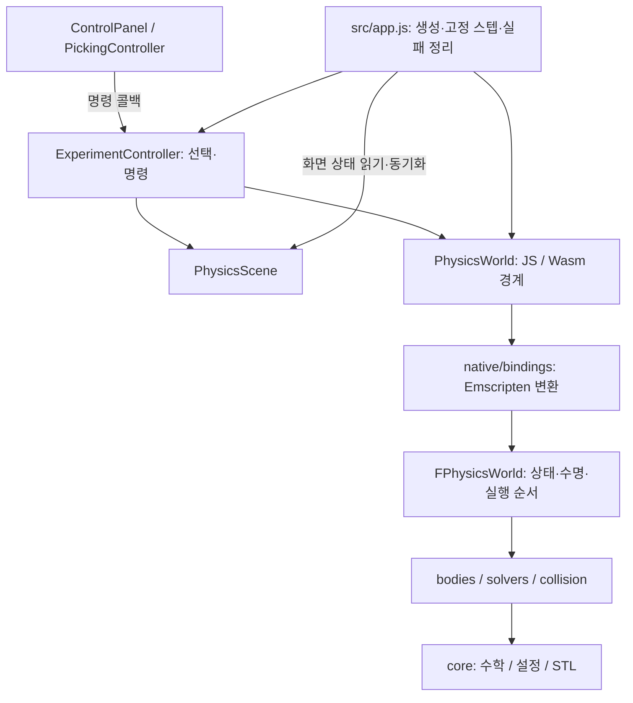

# PBD 프로젝트 구조와 계약

공통 설계·코딩 규칙은 [project-conventions.md](project-conventions.md)를 따릅니다.
이 문서는 PBD의 실제 모듈과 예외를 기록합니다.

## 책임표

| 모듈 | 소유하는 상태 | 외부 계약 |
| --- | --- | --- |
| `src/app.js` | 시간 누적기, RAF, 모듈 수명 | 초기화·`world.step()` 순서 조율. 화면 객체 생성은 scene에 위임 |
| `ExperimentController` | 선택 body/obstacle·실행 상태·명령 callbacks | UI·picking에 제한된 actions/selection 계약 제공. world 명령 성공 뒤 scene/UI 갱신 |
| `PhysicsWorld` | 네이티브 owner handle, JS body/obstacle 대응 | `configure()`와 장애물 추가·편집·제거는 네이티브 검증 뒤 JS mirror를 반영. 입자 getter는 Wasm 메모리 증가 후 재취득 |
| `PhysicsScene` | Three.js scene/camera/renderer/controls, 메시 Map, ResizeObserver | `addBody`/`syncBody`/`syncObstacle`/`render`는 물리 상태를 읽음. 물리 step 호출·수치 상태 수정 없음 |
| `ControlPanel` | DOM 리스너와 AbortController | world를 읽고 `actions`에 명령 전달. Three.js 생성·물리 상태 수정 없음 |
| `PickingController` | raycaster, drag plane, 포인터 리스너 | 선택 getter를 빌리고 이동·drag target 명령을 전달. world는 dt 읽기만 사용 |
| `FPhysicsWorld` | `std::unique_ptr<FBody>`, 하위 솔버, 설정·접촉 상태 | 공통 서브스텝·signed volume·λ 초기화·접촉 수집/투영 순서 보존 |

## 의존 흐름



## 소유권·수명

화면 서비스는 class의 constructor → update 메서드 → 재진입 가능한 `dispose()` 수명을 따릅니다.
`PhysicsScene.dispose()`는 observer·OrbitControls·geometry/material/shadow map·renderer를 해제합니다.
`ControlPanel`과 `PickingController`는 event signal을 중단합니다.
app은 RAF 취소 → DOM 이벤트 중단 → picking/UI/controller → scene → world 순으로 정리합니다.
각 해제 작업은 앞선 작업의 예외와 관계없이 시도합니다. 정리 중 발생한 오류는 최초 실패를
덮어쓰지 않으며, scene의 geometry·material도 개별 해제 단위로 처리합니다.
controller는 world/scene/UI를 소유하지 않으며 dispose 뒤 보존된 actions도 명령을 거부합니다.
초기화 도중 실패·프레임 예외·WebGL context loss는 같은 정리/배너 경로를 사용합니다.
BFCache에 보존되는 pagehide에서는 모듈을 해제하지 않습니다.

## 명령·조회·실패

설정은 `configure`, 장애물은 `addObstacle`/`updateObstacle`/`removeObstacle`,
입자·물체 이동은 검증된 명령을 호출합니다. 잘못된 설정·형상·소유자는 예외로 거부하고
검증 성공 뒤 JS mirror를 반영합니다. 기존 mutable obstacle mirror는 과거 소비자 호환용이며
현재 app은 명령만 사용합니다. Wasm 배열 조회는 호출 직후 재취득하고 owner dispose 이후
body 접근은 오류입니다. app이 오류 배너와 공통 cleanup을 담당합니다.
`FPhysicsWorld::GetSettings()`는 const 참조만 반환합니다. 설정 편집은 값 복사본을 만든 뒤
`Configure()`로 요청하며, 후보 전체와 후보 `Dt` 검증에 성공한 경우에만 교체합니다.
JS 어댑터는 마지막으로 native 적용에 성공한 입력 스냅샷을 보관합니다. 매 step에서 값과
장애물 identity·순서를 비교하여 변경된 입력만 변환·전달합니다. 공개 mirror의 직접 수정은
계속 감지하며, 검증 실패는 성공 스냅샷을 갱신하지 않습니다.
입자 TypedArray는 실제 native 메모리의 writable 대여이며 C++ const가 JS 쓰기를 막지는 않습니다.
호환 소비자의 직접 쓰기는 topology/rest 불변식과 bounds/Prepare 갱신 전제를 지켜야 합니다.
현재 app의 위치·설정·장애물 편집은 명령 경계를 통과합니다.

Wasm world/독립 solver는 `TOwnerRegistry`가 `unique_ptr`로 소유합니다. 두 종류가 공유하는
32비트 토큰 공간에서 주소와 독립된 ID를 발급하며, 해제한 ID는 재사용하지 않습니다.
ID 소진은 신규 등록 오류이고 기존 owner는 유지됩니다. 종류가 다르거나 만료된 토큰의
조회는 거부하며 삭제는 무시합니다. body는 기존 주소 기반 관찰 ABI를 유지하므로 raw body
호출자는 유효한 포인터와 소유 world 수명을 보장해야 합니다.

독립 solver owner는 [FContactSession](../native/bindings/ContactSession.h)입니다.
접촉 배열과 native generation을 비공개로 소유하여 준비 성공 후 무효화와 투영 전 토큰 검사를
한 객체에서 수행합니다. 바인딩은 JS 값 변환·직렬화만 담당하며 mutable Core/Pending을 노출하지 않습니다.

독립 `SoftContactSolver.prepare()`는 현재 owner 집합만 유지합니다. body 객체 identity가
바뀌면 새 native solver를 candidate로 준비한 뒤 성공 시 교체합니다. 같은 owner는 캐시를
재사용합니다. 각 성공한 준비에 JS batch generation을 부여하므로 native solver가 바뀌어
native generation 값이 반복되어도 이전 contact 투영은 거부합니다. 새 owner 준비 실패는
기존 batch를 보존하며, 같은 owner refit의 내부 할당 실패는 native의 basic guarantee입니다.
native 준비는 새 토폴로지의 셀 인덱스·BVH를 후보 캐시에서 완성한 뒤 등록하며, 기존 항목은
`RefitBodySpatialCache`에서 두 공간 표현을 같은 위치로 갱신합니다. 널 몸체는 변경 전에 거부하고
batch 통계는 모든 요청 body가 준비된 뒤 교체합니다. 기존 entry refit의 전체 rollback을
보장하지 않으며 raw native cache의 이전 등록 body 수명은 caller가 유지합니다.

근거: [physics.js](../src/simulation/physics.js), [Bindings.cpp](../native/bindings/Bindings.cpp),
[app.js](../src/app.js), [ExperimentController](../src/experiment-controller.mjs), [회귀 검사](../tests/unit/wasm-adapter.test.mjs).

## 빌드 산출물과 실행 형식

- 개발 원본 `src/app.js`는 ES module이며 배포 HTML은 `dist/app.js` 번들을 실행합니다.
  배포 번들은 Wasm을 내장하여 HTTP와 직접 파일 실행을 모두 지원합니다.
  `experiment-controller.mjs`는 명시적 ES module이므로 브라우저와 Node 검사에서 같은 클래스를 import합니다.
- `src/simulation/physics.js`, `soft-contacts.js`, `src/data/bunny-data.js`는 기존 Node `require`와
  브라우저 전역 API를 함께 지원하는 UMD 경계입니다. `package.json`은 CommonJS입니다.
  generated `wasm/pbd_core.js`의 Emscripten 형식과 기존 회귀 fixture를 보존하기 위한 예외입니다.
- Boids의 C ABI 고정 메모리와 PBD의 Embind·메모리 증가는 각 코어의 실제 수명 계약입니다.
  두 코어의 메모리 모델이나 Three.js 버전은 구조 통일을 이유로 변경하지 않습니다.
- `native/sources.txt`는 domain과 bindings의 전체 구현 목록입니다. 프로젝트 상대 경로를
  CMake와 Wasm 빌드가 공유하며 native 빌드는 Emscripten 전용 `native/bindings/`를 제외합니다.
- 배포 빌드는 `wasm/build-manifest.json`에 SDK·portable argv·현재 source/output 해시를 기록합니다.
  텍스트는 LF로 정규화하고 Wasm은 raw bytes로 해시합니다. `npm run check`가 배포 산출물과
  현재 원본의 일치를 검사합니다. native `/WX`·Wasm `-Werror`로 경고를 실패 처리합니다.
- `npm run build`는 원본/Wasm 대조 후 `dist/` 웹 번들을 생성합니다. `build:core`는 Wasm을 재컴파일하며,
  `npm run test:native`는 공통 CMake/CTest Debug 검사를 실행합니다.

## 폴더 배치

```text
native/
  src/{core,simulation,collision}/
  bindings/Bindings.cpp
  sources.txt
  CMakeLists.txt
src/
  app.js
  experiment-controller.mjs
  simulation/{physics,soft-contacts}.js
  rendering/scene.js
  ui/{controls,picking}.js
  data/bunny-data.js
tools/
  build_wasm.py, build_native.ps1, vscode.ps1, serve.py
tests/
  unit/, native/, browser/, fixtures/, legacy/
docs/
wasm/        재빌드하는 배포 산출물
build/       네이티브 빌드와 변경 전 보존본
artifacts/   현재 검증 결과
```

원본 영상·PDF·추가설명과 학습 자료는 기존 위치에 보존합니다.
`tests/artifacts/`의 과거 실행 로그는 당시 경로·검사 수를 가진 역사 자료입니다.
현재 검증 결과로 자동 승계하지 않습니다.

## 검증과 피드백

`npm run check`로 공통 구조·포맷을, `npm test`로 실제 Wasm을 검사합니다.
`npm run test:native`와 `npm run test:browser`는 네이티브·화면 수명을 별도로 검사합니다.
독립 검증 피드백으로 picking의 직접 dragTarget 쓰기를 명령 콜백으로 옮기고,
초기화·프레임 실패의 owner 정리 및 반복 dispose 가드를 추가했습니다.
설정 명령의 실패 원자성은 `tests/unit/wasm-adapter.test.mjs`로 검사합니다.
장애물도 `addObstacle`/`updateObstacle`/`removeObstacle` 명령을 사용하며 잘못된 기하·범퍼 설정과
다른 world 객체를 거부합니다. 성공한 편집은 기존 객체 identity를 보존합니다.
기존 공개 mutable obstacle mirror는 과거 테스트·소비자의 호환성을 위해 남기며 앱은 명령만 사용합니다.
실제 실행 결과와 최종 승인 여부는 이번 검증 로그 및 통합 보고서를 따릅니다.

네이티브 클래스·입자 수명 상세는 [cpp-architecture.md](cpp-architecture.md)를 확인합니다.

## 2026-11-07 코어 독해 경로

`FPhysicsWorld::AdvanceSubstep`은 전체 처리 순서를 소유합니다. 재질 제약은
`FConstraintSolver::SolveEdges/SolveVolumes`에서 입력 순서로 순회하고,
비공개 `ProjectEdge/ProjectVolume`이 한 제약의 평가·승수 누적·위치 보정을 완료합니다.
하나의 사면체의 모든 gradient를 평가한 뒤 입자를 수정하며 다음 제약은 수정된 현재 위치를 읽습니다.

`FSoftBody`는 검증 → `InitializeRestEdgeLengths` → `InitializeRestVolumesAndLimits`
→ 승수 저장소 생성 → bounds 갱신 순서로 구성합니다. `FTimeIntegrator::PredictParticle`은
고정 입자와 드래그/중력 적분을 구분하며 `Predict`가 전체 이전 위치와 제약 풀이 전 속도 저장 시점을 관리합니다.

바인딩의 `ResolveHandle`은 기존 registry/주소 계약으로 객체를 찾습니다.
`ReadVector/ReadDoubleArray/ReadInverseMasses`는 JS 입력 변환,
`ToArray`는 JS 배열 복사, `BorrowMemoryView`는 native 저장소의 비소유 대여입니다.
외부 등록 문자열과 필드 번호는 보존합니다. 전체 검사는 `npm run verify`로 실행하며
소스·배포물 해시와 각 종료 코드는 `artifacts/validation.json`에 기록합니다.


C++ 파일의 공통 배치와 기존 경로의 이동 기준은 [native 내부 구조](native-layout.md)를 따릅니다.
