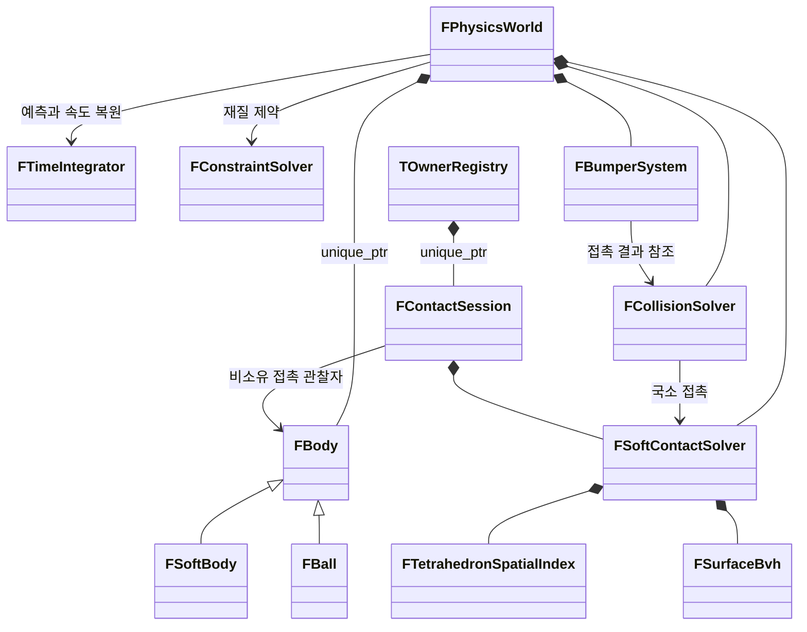

# C++20 물리 코어 구조

실제 native/Wasm 빌드 표준은 C++20입니다. 공개 `backend` 문자열
`C++17 / WebAssembly`는 기존 소비자와의 호환성을 위해 유지한 식별자입니다.
실제 배포 표준은 `wasm/build-manifest.json`의 `languageStandard`로 확인합니다.

렌더링은 기존 Three.js 장면·재질·카메라·BufferGeometry와 `requestAnimationFrame` 루프를 유지합니다.
물리 상태의 소유권과 계산은 C++ 코어로 이동했습니다. JavaScript는 UI 값을 전달하고,
결과 위치를 기존 렌더 버퍼에 복사합니다. 객체의 일시정지 이동도 `FBody::MoveTo()`에서 처리합니다.

## 모듈과 클래스

```text
native/
  src/
    core/       Vector3D.h, MathUtils.h, Settings.h/.cpp
    simulation/ Body.h/.cpp, SoftBody.h/.cpp, Ball.h/.cpp,
                TimeIntegrator.h/.cpp, ConstraintSolver.h/.cpp,
                PhysicsWorld.h/.cpp
    collision/  Contact.h, CollisionSolver.h/.cpp,
                SoftContactSolver.h/.cpp, BumperSystem.h/.cpp
                SurfaceTopology.h/.cpp, TriangleGeometry.h/.cpp,
                TetrahedronSpatialIndex.h/.cpp, SurfaceBvh.h/.cpp
  bindings/     Bindings.cpp, OwnerRegistry.h, ContactSession.h
  sources.txt
```

| 클래스 | 책임 | 소유하는 상태 |
| --- | --- | --- |
| `FBody` | 공통 입자 상태, 초기화·이동 인터페이스 | 위치·이전 위치·속도·역질량·드래그 목표 |
| `FSoftBody final : FBody` | 연체 메시와 경계 갱신 | 인덱스·rest 길이/부피·제약 λ |
| `FBall final : FBody` | 단일 입자 구형 물체 | 반경과 중심 |
| `FTimeIntegrator` | 중력·감쇠·드래그에 따른 예측, 보정 후 속도 복원 | 없음 |
| `FConstraintSolver` | PBD/XPBD 엣지·signed volume 제약 투영 | 없음. λ는 FSoftBody에 저장 |
| `FTetrahedronSpatialIndex` | 조밀·희소 셀 후보와 사면체 포함 검사 | 사면체 역기저·경계, 셀 목록, 초과 목록 |
| `FSurfaceBvh` | 표면 BVH 구축·경계 갱신·최근접점 탐색 | 표면 인덱스·노드·정렬 순서·순회 스택 |
| `FSoftContactSolver` | 공간 자료구조 준비, 접촉 생성·투영·통계 조율 | 몸체별 두 공간 컴포넌트 |
| `FCollisionSolver` | 구·벽·장애물 접촉, 반발 응답, 편집 후 접촉 안정화 | 현재 서브스텝의 접촉 목록 |
| `FBumperSystem` | 능동 범퍼의 진입·쿨다운·발사 이벤트 | 객체–장애물 쌍별 이력·이벤트·그룹/정점 임시 저장소 |
| `FPhysicsWorld` | 객체 소유와 서브스텝 실행 순서 조율 | `std::unique_ptr<FBody>` 목록·설정·장애물·각 하위 시스템·시간 |
| `TOwnerRegistry` | Wasm owner 등록·종류 검사·해제 | 공통 ID 공간, `variant<std::unique_ptr<...>>` 등록 저장소 |
| `FContactSession` | 독립 solver의 준비·접촉 배치 생성·세대 검증 투영 | `FSoftContactSolver`, 비공개 Pending/Generation |



`FBody`는 `std::vector<double>`로 입자 저장소를 소유하고, 조회에는 `const std::vector<double>&`를 반환합니다.
외부 편집은 인덱스와 값을 검증하는 `SetParticlePosition()`, `SetParticleVelocity()`,
`SetParticleInverseMass()`를 사용합니다.
저장소와 형상 상태는 모두 private이며, 파생 클래스는 크기 변경 권한을 갖지 않습니다.
`FSoftBody`와 `FBall`은 계산한 경계 결과를 protected `PublishBounds()`로 전달합니다.
`FPhysicsWorld`의 상태와 `FSoftContactSolver`의 공간 캐시는 비공개입니다.
`FSettings`, `FContactOptions`, `FContactBodyInfo`, `FObstacle`, `FContact`, `FHit`, `FStats`는
설정·결과 전달용 구조체입니다. `FContactOptions`는 검증 후 `Configure()`로 적용하고,
통계는 const 참조로 조회합니다. `FContactBodyInfo`는 캐시 내부 타입을 노출하지 않는 소유형 진단 스냅샷입니다.
코어에는 Three.js·DOM·Emscripten 타입이 없습니다. `bindings/`만 브라우저 런타임에 의존합니다.

`FTimeIntegrator`와 `FConstraintSolver`는 상태 없는 계산 진입점입니다. World가 불필요한
FConstraintSolver 인스턴스를 소유하지 않으며, 계산은 명시적 정적 호출로 실행합니다.
독립 수학 함수는 namespace에 두고 소유권·수명·불변식이 있는 모듈에 클래스를 사용합니다.

## 실행 순서와 수명 계약

`FPhysicsWorld::Step(dt)`는 진입 검증과 프레임 시작을 담당합니다. private `AdvanceSubstep()`이
서브스텝을, `SolveIteration()`이 제약 반복을 조율하며 다음 순서를 유지합니다.

1. 모든 물체의 이전 위치 저장, 연체 λ 초기화, 위치 예측.
2. 설정한 반복 수만큼 엣지 → 부피 → 동적 접촉 → 벽/장애물 접촉 계산.
3. 보정 위치로 속도 복원, 접촉 법선 반발 처리, 범퍼 처리.
4. 시뮬레이션 시간 증가.

λ는 서브스텝 내부 반복 동안 누적합니다. 국소 접촉은 모든 후보 쌍을 같은 위치 스냅샷에서
수집한 뒤 투영합니다. 반발은 제약 풀이 전 스냅샷 `PreSolveVelocities`를 기준으로 처리해 겹침 해소가 발사 에너지로 바뀌지 않게 합니다.
범퍼는 외부 에너지를 공급하는 독립 단계입니다. `dt=0`은 물리 상태를 변경하지 않습니다.

`FPhysicsWorld`가 물체를 소유합니다. 반환한 물체 포인터·버퍼는 world보다 오래 사용할 수 없습니다.
입자/λ와 토폴로지/rest 조회는 모두 읽기 전용 const vector 참조입니다.
읽기에는 `const std::vector<double>&` 또는 `const FIndices&`처럼 명시 타입의 const 참조를 사용하고, 독립 스냅샷에는 의도적인 vector 복사를 사용합니다.
외부 위치 편집 뒤에는 bounds를 갱신합니다. 다섯 계산 커널은 명시적 friend로 원소만 수정합니다.
friend 내부의 resize까지 컴파일러가 막지는 않으므로 내부 계약과 리뷰로 저장소 크기를 보존합니다.
`Reset()`은 최초 위치·영속도를 복원하고 장애물을 유지합니다.
장애물 목록은 `SetObstacles()`로 교체하며, 유한한 위치·양수 치수·중복 없는 양수 ID를 코어에서 검증합니다.

브라우저의 `PhysicsWorld`·`Body`는 네이티브 객체를 가리키는 어댑터입니다.
위치 버퍼는 C++ `double` 메모리의 writable `Float64Array` 뷰로 노출합니다.
const vector 조회는 C++ 호출자의 계약이며 이 호환 JS 뷰를 읽기 전용으로 강제하지 않습니다.
생성 뒤 topology/rest 배열을 바꾸지 않고 직접 위치를 편집하면 bounds/공간 캐시를 다시 준비합니다.
Wasm 메모리 증가 시 이전 뷰가 분리되므로 매번 getter로 다시 얻어야 합니다.
렌더러는 결과를 Three.js의 `Float32Array` 버퍼에 한 번 복사합니다.
명시적 `dispose()`와 GC 정리 경로를 제공하며, 해제한 world의 Body 접근은 오류로 처리합니다.
독립 `SoftContactSolver` 어댑터는 참조하는 Body의 소유자를 유지하고, 오래된 접촉 배치의 재사용을 거부합니다.
C++ 예외는 JavaScript의 `TypeError`·`RangeError` 등으로 변환하고 네이티브 예외 저장소를 해제합니다.

world/solver 토큰은 주소를 사용하지 않습니다. `TOwnerRegistry`가 공통 ID 공간에서 단조 증가
토큰을 발급하고 종류를 검사하므로 해제 후 주소 재사용이나 다른 종류의 토큰으로 새 owner를
조회·파괴할 수 없습니다. body 관찰 ABI는 주소를 유지하며 JS world 수명 검사 안에서 사용합니다.

`FContactSession`은 기존 독립 solver의 Core/Pending/Generation을 함께 소유합니다.
`Prepare()`는 Core 준비에 성공한 뒤 Pending을 비우고 세대를 진행합니다. 실패하면 Pending과
세대는 유지하고, Core 내부 refit 실패는 기존 basic guarantee를 따릅니다. `Generate()`는
추가한 접촉 범위와 세대만 반환하며, 직렬화는 `GetContact()`의 const 참조를 사용합니다.
`Project()`가 세대·인덱스를 확인한 뒤 투영합니다. 여러 접촉 중 후속 입력이 실패해도 앞선
투영을 롤백하지 않는 기존 순서를 유지합니다. 세션은 몸체를 소유하지 않으며 JS 어댑터가
기존 world owner 유지·교체를 계속 담당합니다. mutable Core/Pending 조회는 제공하지 않습니다.

네이티브 `FSoftContactSolver`는 몸체를 소유하지 않으며 위치 변경 뒤 `Prepare()`로 기하 캐시를 갱신합니다.
설정 적용 성공 시 캐시를 비우고, 잘못된 설정은 변경 전에 거부합니다. 몸체 수명 동안 토폴로지는 고정합니다.
BVH 중심 배열은 구축 시 한 번 계산하고, 최근접 탐색 스택과 동적 충돌 임시 배열은 capacity를 재사용합니다.
접촉 수집 → 전체 투영의 순서와 수치식은 유지합니다. solver/world는 직렬 호출을 전제로 합니다.
범퍼 그룹의 최초 출현 순서와 중복 정점의 최초 접촉 방향은 보존하면서 그룹별 vector 용량과
정점 generation 배열을 재사용합니다. 성공한 적용과 Reset 뒤 빌린 포인터를 비웁니다.
구가 없는 장면에서는 구–연체 후보 검사에만 필요한 첫 bounds 갱신을 생략하며,
연체–연체 후보 수집 전 갱신은 유지합니다.

raw `FSoftContactSolver`의 body 관찰자는 owner가 아닙니다. 몸체를 파괴한 뒤 이전 캐시·접촉을
재사용하지 않습니다. JS의 독립 solver는 owner 객체 identity가 바뀔 때 candidate native solver를
준비하여 성공 후 교체하고, JS batch generation으로 이전 contact를 거부합니다.
같은 owner 집합의 위치 변경은 기존 캐시 refit을 사용합니다.
native `PrepareBody`는 새 entry의 표면/BVH 토폴로지와 셀 인덱스/BVH 위치 refit을 완료한 뒤
등록합니다. `RefitBodySpatialCache`는 포함 검사와 최근접 표면이 같은 위치를 보게 두 공간 표현을 함께
갱신합니다. `Prepare`의 batch 진단은 모든 body 준비 뒤 발행합니다. 기존 entry의 refit 할당
실패에서는 basic guarantee를 유지하며 raw body 등록 수명은 caller가 관리합니다. 상세 계약은 [코드 독해 가이드](code-reading.md)를 확인합니다.

## 헤더에서 확인할 호출 계약

| API | 선행 조건과 실패 | 변경·대여 수명 |
| --- | --- | --- |
| `FBody::SetParticle*` | index·유한값·역질량 검증. 실패는 기존 저장소 보존 | 대상 원소만 변경, 위치 편집 뒤 bounds 갱신 필요 |
| `FConstraintSolver::Solve*` | 양수 seconds와 유한한 compliance/dt²는 world/binding이 검증 | positions/λ 원소만 변경. topology·rest·버퍼 크기는 유지 |
| `FTimeIntegrator::Predict/UpdateVelocities` | 양수 seconds, 직렬 호출 | 이전 위치·제약 풀이 전 속도 스냅샷 보관과 위치·속도 갱신 뒤 bounds 복구. soft λ는 substep 시작에 초기화 |
| `FPhysicsWorld::Configure/GetSettings` | 설정 후보와 후보 Dt 검증 후 교체, 조회는 const 참조 | 잘못된 후보는 설정과 실행 상태 모두 보존. 성공 시에도 입자·통계·시간 유지 |
| `FPhysicsWorld::Step` | dt=0도 먼저 설정 검증. 사전 검증 실패·유효한 dt=0은 진행 상태 전체 보존 | 양수 step에서만 clock·통계·hit 갱신. 실행 중 할당 실패 rollback 미보장 |
| `FPhysicsWorld::Reset/Settle` | 유효한 소유 객체 | Reset은 topology/settings/obstacles/주소 유지. Settle은 clock 진행 없이 이동 입자 속도만 제거 |
| `FSoftContactSolver::Prepare` | 살아 있는 body, 고정 topology, 위치 편집 후 재호출 | 새 entry 완성 뒤 등록·batch 통계는 마지막 발행. 기존 refit 할당 실패 basic guarantee |

`SubstepSeconds`, `ScaledCompliance`, `InverseMass*`, `DeltaLambda`, `VolumeGradients`는
XPBD 식의 의미와 단위를 드러냅니다. barycentric 역행렬 행과 테트라 원점 기준 edge도
명시적으로 이름 붙였으며 식의 괄호·순회·보정 순서는 보존합니다.

## 빌드와 비교 기준

`native/sources.txt`를 CMake 네이티브 빌드와 `tools/build_wasm.py`가 함께 사용합니다.
Emscripten 4.0.23, C++20, `-O3 -DNDEBUG`, 부동소수점 연산 결합 비활성화로 배포 Wasm을 빌드합니다.
네이티브 Debug를 별도 유지하고, 편집 명령의 인덱스·값 검증은 배포 구성에서도 실행합니다.
배포 파일은 `wasm/pbd_core.js`, `wasm/pbd_core.wasm`입니다. SDK는 실행 시 필요하지 않습니다.

기존 JavaScript 코어는 `tests/fixtures/physics-reference.js`와
`tests/fixtures/soft-contacts.js`에 비교용으로 보존했습니다. 실행 HTML은 이를 불러오지 않습니다.
`tools/benchmarks/cpp.mjs`는 같은 메시·객체 수·초기 위치와 설정으로 두 코어를 비교합니다.
측정에는 JS/Wasm 연결 비용을 포함하며 렌더링·GPU 시간은 제외합니다.
충돌의 장기 궤적이 비트 단위로 같다고 보장하지 않습니다.

현재 소스의 독립 판정과 실제 실행 범위는 [독립 리뷰](portfolio-review.md)를 확인합니다.
판정 기준과 소스·배포물 지문은 [품질 기준](quality-standard.md)을 따릅니다.
과거 과제 PDF·영상·벤치마크·작업 보고서는 공개 범위에서 제외하며 현재 성능 근거로 사용하지 않습니다.
명명·주석·서식은 [C++ 적용 규칙](cpp-coding-standard.md)에 정리합니다.
