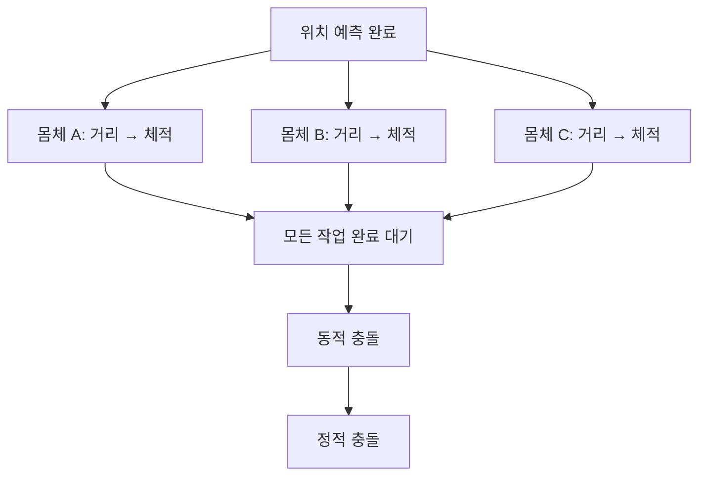

# 몸체 단위 제약 병렬화

공통 실행 코어의 책임·워커 수명·Boids와의 분할 정책 차이는
[공통 병렬 실행기](parallel-executor.md)를 따릅니다.

`FPhysicsWorld::SolveIteration`은 연체별 `SolveEdges → SolveVolumes`를 하나의 작업으로
묶어 `FParallelExecutor`에 전달합니다. 실행기는 `std::thread` 작업자를 재사용하고
호출 스레드도 작업을 처리합니다. 모든 작업의 완료와 메모리 동기화 이후에만
기존 순서대로 동적 충돌과 정적 충돌을 계산합니다.

스레드와 동기화 상태는 `ParallelExecutor.h`의 전역 `struct FParallelExecutorState`에
선언하고 함수 구현은 `.cpp`에 둡니다. `FParallelExecutor`가 상태를 단독 소유합니다.

## 저장소와 동기화 계약

| 데이터 | 접근자와 계약 |
| --- | --- |
| `Positions`, `EdgeLambdas`, `VolumeLambdas` | 한 작업이 한 몸체의 배열만 수정합니다. 몸체 사이에 저장소를 공유하지 않습니다. |
| 기준 형상·토폴로지·역질량·`Settings` | 작업 중 읽기 전용입니다. 호스트는 설정과 입자 편집을 직렬화합니다. |
| `ConstraintBodies` | 월드가 소유하는 비소유 포인터 목록입니다. 실행 전에 구성하고 완료까지 고정합니다. |
| 작업 구간·세대·완료 수 | `Run`은 `FixedRanges` 정책으로 참여자마다 연속 몸체 구간 하나를 맡깁니다. 다음 몸체를 가져오는 잠금은 없으며 게시·세대·완료 상태만 공통 실행기의 mutex로 보호합니다. |
| `Collisions`, `SoftSolver`, `Stats` | 제약 작업에서는 접근하지 않습니다. 모든 제약 작업 종료 후 호출 스레드가 사용합니다. |

`Run`은 const 인덱스 함수 객체를 빌려 `ExecuteRangesAndWait`에 연결합니다.
`std::function` 변환·복사 없이 작업 종료와 쓰기 가시성을 함께 보장합니다. 같은 몸체 안의 제약 순서,
부동소수점 누적 순서, 충돌 순서는 유지합니다. 변이나 사면체를 개별 작업으로 분할하지 않습니다.
`unique_ptr` 자체가 스레드 안전성을 보장하는 것은 아닙니다. 공개 월드/몸체 호출과
렌더링 조회, Wasm TypedArray 편집은 `Step`과 동시에 수행하지 않습니다.

## 수명·실패

- 기본 백그라운드 작업자는 `min(3, hardware_concurrency - 1)`이며 보고값이 0/1이면 순차입니다.
  C++에서 `FPhysicsWorld(0)`으로 순차 실행을 선택하여 비교할 수 있습니다.
- 연체가 0/1개이면 작업자를 생성하지 않습니다. 2개 이상인 첫 반복에서 풀을 생성합니다.
  이후 반복과 `Reset`은 풀을 재사용합니다. 작은 몸체 여러 개에서는 동기화 비용이 더 클 수 있습니다.
- 월드의 마지막 멤버인 실행기를 먼저 파괴합니다. 종료 통지와 모든 `join`이 끝난 후
  몸체·목록·동기화 저장소를 해제합니다. `detach`는 사용하지 않습니다.
- 작업 함수와 실행 경계는 `noexcept`이며 `try/catch`, `exception_ptr`를 사용하지 않습니다.
  Step에서 시간·유연도를 검증한 뒤 void 솔버를 실행하므로 몸체별 결과 배열은 필요하지 않습니다.
  내부 시간·유연도 계약 위반은 배포 빌드에서도 즉시 종료합니다. 접촉 준비의 토폴로지 오류는
  작업 완료 후 호출 스레드에서 FOperationResult로 반환하며 이미 적용한 보정은 롤백하지 않습니다.
- `std::thread` 생성과 동적 할당의 자원 부족은 복구 가능한 상태로 변환하지 않고
  프로그램 종료 정책을 따릅니다. 표준 스레드 생성에는 오류 코드 반환 오버로드가 없습니다.
- Wasm은 모듈 전체의 Worker 예산 3개를 생성 전에 원자적으로 예약합니다.
  예약 실패 시 해당 실행기는 순차 모드로 전환하고, 정상 종료·join 후 예약을 반환합니다.
- 실행기의 재진입, 동시 `Run`, 실행 중 파괴는 지원하지 않습니다.

## Wasm과 배포

`npm run build:all`은 Emscripten 4.0.23으로 두 코어를 빌드합니다.

| 산출물 | 용도 |
| --- | --- |
| `wasm/pbd_core.js`, `.wasm`, `build-manifest.json` | 기존 순차 실행과 `file:` 호환 |
| `wasm/pbd_core_threaded.js`, `.wasm`, `build-manifest-threaded.json` | `std::thread` 공유 메모리 실행 |

병렬 빌드는 `-pthread`, `PTHREAD_POOL_SIZE=3`, `PTHREAD_POOL_SIZE_STRICT=2`를 사용합니다.
모듈 초기화가 완료되기 전에 Worker 3개를 준비합니다. 풀이 부족하면 추가 Worker의
비동기 시작을 기다리지 않고 생성 전 예산 예약 실패를 순차 경로로 처리합니다. 여러 월드가
한 모듈을 공유하면 뒤에 실행되는 월드가 순차 모드가 될 수 있습니다.

`src/load-core.mjs`는 `crossOriginIsolated`와 `SharedArrayBuffer`를 확인하여 코어를
선택합니다. Node·Python 개발 서버와 Electron 자원 응답에는 COOP/COEP 헤더를 설정합니다.
외부 서버에도 같은 헤더가 필요합니다. 직접 파일 실행과 격리되지 않은 서버는 순차
코어를 사용합니다. 선택한 코어의 로딩 실패는 기존 앱 오류 처리로 전달합니다.

성장 가능한 Wasm 메모리 계약을 유지합니다. Emscripten의 `pthreads-mem-growth` 성능
경고는 표시하되 해당 경고만 오류 승격에서 제외합니다. 모든 다른 `-Werror` 검사는
유지합니다. JS는 매 조회에서 현재 메모리 뷰를 다시 취득해야 합니다.

현재 앱의 동기 `Step` 계약도 유지합니다. 브라우저 메인 스레드는 제약 작업의 완료를
기다리므로 UI가 물리 스텝과 동시에 진행하는 구조는 아닙니다. 작업자 안에서는 DOM,
Embind, 메인 스레드로 프록시되는 JS 함수를 호출하지 않습니다.

근거: [Emscripten pthread 문서](https://emscripten.org/docs/porting/pthreads.html),
고정 SDK의 `src/lib/libpthread.js` 및 현재 빌드 manifest.

## 재현 검사

- `npm run verify`: 재빌드, 서식·구조·두 코어 해시, Node 회귀, 네이티브 Debug/Release,
  기존 브라우저 검사와 병렬 Wasm 수치 비교를 실행합니다.
- `tests/native/test_parallel.cpp`: 동시 실행, 작업 누락·중복, 작업 상태 확인 후 재사용,
  PBD/XPBD 순차 대비 완전 일치, dt=0/잘못된 dt, Reset 후 추가, 반복 파괴를 검사합니다.
- `tests/unit/parallel-wasm.test.mjs`: 순차/병렬 Wasm의 위치·속도·승수·통계 및 공유 메모리 증가를 검사합니다.
- `npm run test:parallel`: Chrome에서 공유 메모리와 실제 작업자 생성, 8개 시나리오의 순차 결과 일치를 검사합니다.
- `npm run test:distribution`: HTTP 병렬 선택과 직접 파일 순차 실행의 배포 호환을 검사합니다.
- Release의 `pbd_parallel_tests.exe --benchmark`: 몸체 8개·각 1,000개 사면체,
  예열 5스텝 후 30스텝 전체 `Step` 시간의 중앙값을 출력합니다. GPU 측정이 아닙니다.

실행 결과는 `artifacts/validation.json`과 `artifacts/threading-20261108/`에 기록합니다.
기존 리뷰 승인이나 과거 성능 측정을 현재 변경의 검증으로 재사용하지 않습니다.
