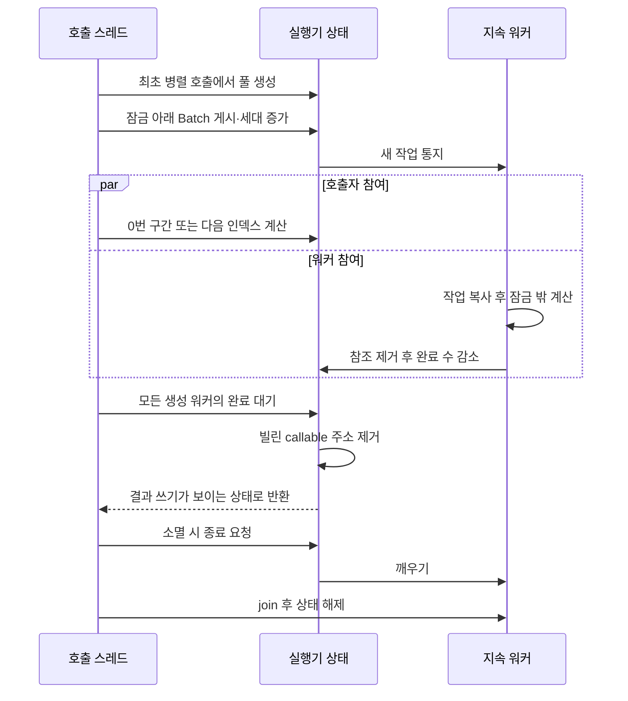

# Boids·PBD 공통 병렬 실행기

두 프로젝트의 `native/src/simulation/ParallelExecutor.h/.cpp`는 같은 구현입니다.
각 저장소가 독립적으로 빌드되도록 두 파일을 각각 보관합니다. 형제 저장소나 외부 UE
라이브러리를 링크하지 않습니다. 공통 파일을 수정할 때는 두 저장소의 파일을 함께
갱신하고 해시·네이티브·Wasm 검사를 다시 수행합니다.

## 환경과 작업 단위

| 환경 | 워커 정책 | 작업 단위와 보존 계약 |
| --- | --- | --- |
| Boids native | `BOIDS_ENABLE_THREADS`에 따라 공통 빌드 매크로를 1/0으로 지정 | 고정 연속 개체 구간. 기존 int API·하드웨어 상한·최근 참여 워커 수 유지 |
| Boids Wasm·웹·Electron | 공통 스레드 매크로 비활성 | 기존 순차 실행, 고정 2 MiB, 외부 import 없음 |
| PBD native | 공통 스레드 매크로 활성 | 독립 몸체 인덱스 고정 연속 구간 배분. 몸체 안의 거리 → 체적 제약 순서 유지 |
| PBD pthread Wasm | 공통 스레드 매크로 활성, 모듈 전체 최대 3개 예약 | 기존 공유 메모리·성장 가능 메모리·동기 Step 유지 |
| PBD 순차 Wasm·비격리 웹·직접 파일 실행 | 공통 스레드 매크로 비활성 | 같은 작업을 호출 스레드에서 처리 |

공통 매크로는 `PARALLEL_EXECUTOR_ENABLE_THREADS`입니다. native CMake 또는 PBD의
pthread Wasm 빌드가 지정합니다. 작업자 상한은 3이며 호출 스레드는 별도로 참여합니다.
0/1개 작업은 워커를 만들거나 깨우지 않습니다. 기본 상한은
`min(3, hardware_concurrency - 1)`이고 하드웨어 보고값이 0/1이면 기본 순차입니다.
PBD의 명시적 워커 상한과 Boids 어댑터의 하드웨어 제한은 기존대로 구분합니다.

## 책임과 수명

| 타입 | 책임 |
| --- | --- |
| `FParallelExecutor` | 빈 작업·순차·병렬 선택, 최초 풀 생성, 호출자 참여와 완료 대기 |
| `FParallelBatch` | 비소유 callable 주소·호출 함수·인덱스 수·분할 정책 |
| `FParallelExecutorState` | 지속 스레드·mutex·조건 변수·현재 작업·세대·완료 수·종료 상태 |
| `FBirdUpdateExecutor` | Boids의 기존 int 구간 API·하드웨어 제한·telemetry를 공통 실행기에 연결 |
| `FPhysicsWorld` | 몸체 목록과 제약 계산·충돌 계산 사이의 의존 순서 |

`ExecuteRangesAndWait`는 const 호출 가능한 함수 객체를 복사하지 않고 빌립니다.
호출 객체·캡처·배열은 반환까지 유효해야 합니다. `std::function` 변환과 작업별 소유
할당은 없습니다. 최초 병렬 호출의 풀 생성은 할당합니다. `Run`은 기존 PBD 인덱스
API이며 같은 구간 API에 고정 구간 정책을 지정하는 래퍼입니다.

템플릿 진입점은 C++20 `CParallelTask` concept으로 제약합니다. const 객체를
`const void*`로 빌릴 수 있고, 실제 호출의 인자 형식과 값 범주로 직접 호출했을 때
반환형이 `void`이며 호출 표현식이 `noexcept`여야 합니다. `ExecuteRangesAndWait`와
`Run`은 각각 `size_t` lvalue 두 개·한 개, Boids 어댑터는 변환된 `int` 값 두 개를 검사합니다.
원시 함수는 함수 포인터 객체 또는 람다로 전달합니다. 복사 불가능한 작업은 허용합니다.

호출 람다는 ` noexcept { /* 작업 */ }`처럼 `noexcept`를
명시해야 합니다. `mutable`만 제공하는 함수 객체, 인자 수 불일치, 값 반환,
`noexcept` 누락은 오버로드 선택 단계에서 거부합니다. 단, `noexcept`는 선언된 계약을
검사하며 함수 내부의 모든 호출이 실패하지 않는다는 증명은 아닙니다. 캡처 수명,
데이터 경쟁, 같은 실행기의 재진입은 concept으로 검증하지 않습니다.

`FixedRanges`는 기존 `floor(Count * Index / ParticipantCount)` 경계를 유지합니다.
큰 `size_t`의 곱셈 오버플로를 피하도록 몫·나머지로 계산합니다. `DynamicIndices`는
명시적으로 선택할 때만 mutex 아래 다음 인덱스를 가져온 뒤 계산은 잠금 밖에서 수행합니다.
PBD의 `Run`은 고정 구간이므로 몸체 인덱스를 가져올 때 잠그지 않습니다. 게시·세대·완료·종료
상태의 mutex는 유지합니다. 몸체가 달라도 입자 배열을 공유하지 않는다는 전제가 필요합니다.

PBD 고정 구간은 인덱스 배분 잠금을 줄이는 대신 몸체 수를 기준으로만 나눕니다.
큰 몸체가 한 구간에 몰리면 다른 참여자가 먼저 끝나도 재분배하지 않으므로 부하 불균형이
생길 수 있습니다. 제약 수·몸체 크기가 다른 장면에서의 속도 향상은 별도 측정이 필요합니다.

생성된 모든 워커가 매 세대를 확인하고 완료합니다. 고정 구간이 없는 워커는 callable을
실행하지 않고 완료만 알립니다. 따라서 완료 후 이전 호출 스택의 주소를 뒤늦게 가져오는
워커가 없습니다. 게시 조건은 `종료 요청 || 관찰하지 않은 세대`, 완료 조건은
`RemainingWorkerCount == 0`입니다. mutex의 게시·완료 동기화가 입력과 결과를 공개합니다.

`GetWorkerCount()`는 생성된 풀 크기이고 `GetLastExecutionWorkerCount()`는 최근 작업에
배정한 워커 수입니다. 동적 배분에서 실제 각 워커가 처리한 인덱스 수를 측정하는 값은
아닙니다. PBD의 기존 조회는 풀 크기, Boids의 기존 조회는 고정 구간 참여 수를 유지합니다.

같은 실행기의 중첩·동시 호출, 실행 중 파괴는 지원하지 않습니다. 입력 검증은 작업
게시 전에 수행하고 작업은 예외를 사용하지 않습니다. 할당·스레드 생성 자원 소진은
기존 종료 정책을 유지합니다. 소유 객체는 실행기를 마지막 멤버로 두어 배열보다 먼저
워커를 종료합니다. `detach`는 사용하지 않습니다.

PBD pthread Wasm은 생성 전에 모듈 전체 Worker 예산을 원자적으로 예약합니다.
예약이 부족한 실행기는 순차로 전환하며 자동 재시도하지 않습니다. join 후 예약을
반환하므로 이후 새 실행기는 다시 예약할 수 있습니다. UI·Embind·DOM 호출은 워커에
넣지 않습니다. 브라우저 메인 스레드의 동기 완료 대기 계약은 유지합니다.
[Emscripten pthread 문서](https://emscripten.org/docs/porting/pthreads.html)의 준비된
Worker 풀 조건을 따르며 실제 SDK 버전은 프로젝트의 4.0.23으로 고정합니다.

## 참고한 UE 5.8 구현

설치된 `Engine/Source/Runtime/Core/` 아래 소스를 읽고 구조를 참고했습니다.
엔진 코드를 복사하거나 UE ABI·컨테이너·스케줄러를 도입하지 않았습니다.

- `Public/Async/ParallelFor.h:157`: balanced/unbalanced에 따른 batch 분할 차이.
- `Public/Async/ParallelFor.h:397–466`: LowLevelTasks 요청, 호출자 참여, 완료 신호 대기.
- `Private/HAL/ThreadingBase.cpp:1205–1214, 1465–1511`: 작업 게시·통지와 지속 워커 루프.
- `Private/HAL/ThreadingBase.cpp:1181–1202`: 종료 요청·깨우기·완료 대기·자원 해제.

UE는 전역 Tasks 스케줄러와 작업 수명 체계를 사용합니다. 이번 실행기는 한 소유자의
동기 단계만 처리하므로 전역 큐·우선순위·work stealing은 도입하지 않습니다.
[Epic FQueuedThreadPool API](https://dev.epicgames.com/documentation/en-us/unreal-engine/API/Runtime/Core/FQueuedThreadPool)는
작업과 지속 스레드 풀의 책임 구분을 확인하는 공개 참조입니다.

검증은 각 저장소에서 `npm.cmd run verify`로 수행합니다. Boids의 스레드 비활성 CMake
설정도 별도로 확인합니다. 변경 전 Wasm·native 결정적 상태와 변경 후 결과를 비교하며,
구조 변경만으로 성능 향상을 주장하지 않습니다.
