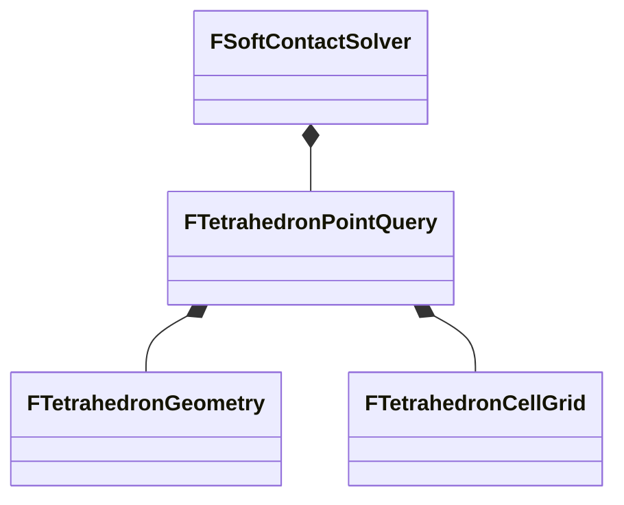

# 사면체 점 질의의 책임과 갱신 계약

2026-11-08에 `FTetrahedronSpatialIndex`를 `FTetrahedronPointQuery`로 개명하고,
한 클래스에 섞여 있던 기하 계산·셀 저장·점 질의를 분리했습니다.
기존 이름은 프로젝트 내부 C++ 타입이며 JS/Wasm 공개 API 이름은 유지합니다.

| 타입 | 책임 | 소유 상태 |
| --- | --- | --- |
| [FTetrahedronPointQuery](../native/src/collision/TetrahedronPointQuery.h) | 몸체에서 기하·셀을 갱신하고 포함 결과와 검사 횟수를 조율 | 원본 번호와 대응하는 기하 배열, 셀 그리드, 허용 오차 |
| [FTetrahedronGeometry](../native/src/collision/TetrahedronGeometry.h) | 사면체 하나의 퇴화·AABB·무게중심 좌표 검사 | 기준 정점, 역기저 세 행, 여유 경계, 유효 상태 |
| [FTetrahedronCellGrid](../native/src/collision/TetrahedronCellGrid.h) | 조밀·희소·초과 후보 등록과 순회 | 셀 크기·등록 한도, 셀 목록, 초과 목록 |

`Rebuild()`는 몸체 경계를 갱신하고 셀 저장소를 비운 뒤 원본 사면체 번호 순서로
기하를 갱신하고 유효한 사면체를 등록합니다. 셀 그리드는 몸체나 기하 배열을 참조하지
않으며 전달받은 AABB와 사면체 번호만 사용합니다. 기하 타입 역시 몸체에 의존하지 않습니다.

점 질의는 셀 후보 → 초과 후보 순서로 기하를 검사합니다. AABB를 통과한 후보에만
검사 횟수를 누적하고 무게중심 좌표 판정을 수행합니다. 포함된 번호는 출력 배열 뒤에
추가하며 `bFirst`이면 실제 순회의 첫 일치에서 중단합니다.

## 보존하는 동작

- 조밀 셀 목록은 역등록 순서, 희소·초과 목록은 원본 등록 순서입니다.
- 조밀 저장소의 전체 셀 수 한도는 262144이며 기존 좌표 안전 검사를 유지합니다.
- 셀 등록 한도나 좌표 범위를 넘은 사면체는 초과 목록에서 조회합니다.
- 자동 셀 크기는 생성 시 기준 형상의 양수 사면체 변 길이 평균으로 결정합니다.
- 행렬식·역기저·퇴화 기준·AABB 여유·무게중심 좌표의 계산식과 계산 순서를 유지합니다.
- `HashCells`는 활성 셀 개수, `CandidateTests`는 AABB 통과 뒤 무게중심 좌표 검사 횟수입니다.
- 호출자는 토폴로지를 유지하고 위치 변경 뒤 다음 질의 전에 `Rebuild()`를 호출합니다.
  갱신과 질의는 직렬화하며 동적 할당 자원 소진은 기존 종료 정책을 따릅니다.

## 검증 경계

[네이티브 회귀 검사](../tests/native/test_refactoring.cpp)는 후보 순서·출력 배열 추가·첫 일치·
검사 횟수·초과 목록과 위치 갱신을 검사합니다. 저장 방식의 반복 전환과 사면체의
붕괴·반전·복원에서 이전 후보나 역기저가 남지 않는 경로를 보강했습니다.

변경 전 기준선과 이번 실행 로그는 `artifacts/tetrahedron-point-query-20261108/`에
보존합니다. 현재 실행 결과는 `artifacts/validation.json`과 해당 로그로 확인합니다.
과거 독립 리뷰 점수는 이번 소스에 승계하지 않습니다. 별도 성능 측정은 포함하지 않습니다.
