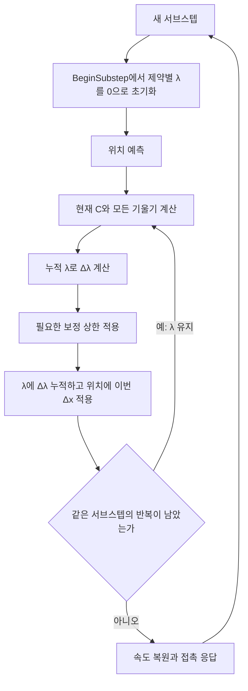

# XPBD의 누적 람다와 DeltaLambda

`DeltaLambda`는 **이번 제약 투영에서 사용할 승수의 변화량**입니다. `EdgeLambdas[e]`와
`VolumeLambdas[t]`는 같은 서브스텝에서 해당 제약에 적용한 변화량을 더한 **누적 λ**입니다.
위치는 이번 `DeltaLambda`로만 보정하고, 누적 λ는 다음 반복의 보정량을 계산할 때 읽습니다.

## 1. 강의의 λ와 코드의 DeltaLambda

거리나 부피 제약은 현재 위치의 오차를 `C(x)`로 표현합니다. 예를 들어 거리 제약은
`C = 현재 길이 - 기준 길이`입니다. 늘어나면 양수, 줄어들면 음수, 기준 길이면 0입니다.

`g_i = ∇x_i C`는 입자 i의 위치 변화에 대한 제약의 기울기이고, `w_i = 1/m_i`는 역질량입니다.
고정 입자는 `w_i = 0`으로 둡니다. 한 번의 위치 보정은 다음 형태로 계산합니다.

```text
DeltaPosition_i = w_i * g_i * DeltaLambda
```

기울기가 방향을, 역질량이 입자별 이동 비율을, `DeltaLambda`가 공통 보정 계수를 결정합니다.
`DeltaLambda` 자체가 위치 벡터나 길이는 아닙니다. 단위도 제약 C의 정의에 따라 달라집니다.

첨부한 PBD 슬라이드는 한 번의 보정 계수를 λ라고 표기합니다.

```text
D = Σ_i(w_i * |g_i|²)
슬라이드의 λ = -C / D
```

이 λ가 하는 역할이 코드의 `DeltaLambda`입니다. XPBD 코드에서는 별도로 누적 λ를
보관하므로, 이번 변화량과 누적값을 구분하여 이름을 붙였습니다. 변화량은 음수일 수도 있습니다.

## 2. XPBD에서 이전 λ를 읽는 이유

XPBD는 유연도 `α_C`를 사용합니다. 0이면 단단한 제약이고, 양수이면 탄성 변형을 허용합니다.
`h`는 프레임 전체 시간이 아니라 실제 `SubstepSeconds`이며, `α̃ = α_C/h²`로 보정합니다.

```text
DeltaLambda = (-C - α̃ * lambda) / (D + α̃)
lambda      = lambda + DeltaLambda
x_i         = x_i + w_i * g_i * DeltaLambda
```

여기서 `lambda`는 현재 제약의 누적값입니다. 첫 투영은 `lambda = 0`이므로 다음처럼 줄어듭니다.

```text
첫 투영: DeltaLambda = -C / (D + α_C/h²)
```

첨부한 XPBD 슬라이드의 식과 같습니다. 서브스텝당 한 번만 투영할 때도 이 식을 사용할 수
있습니다. 같은 서브스텝에서 여러 번 투영할 때는 `-α̃ * lambda`가 이전 보정을 반영합니다.

이 항은 단순히 이전 위치 이동을 한 번 더 빼는 값이 아닙니다. 유연한 제약의 조건은
`C = 0`을 무조건 강제하는 대신 `C + α̃ * lambda = 0`을 만족하도록 정해집니다.
이미 탄성 반응과 균형을 이룬 변형을 반복할 때마다 계속 없애지 않도록 하는 것입니다.
이는 [XPBD 논문](https://mmacklin.com/xpbd.pdf)의 식 (13), (17), (18)에 해당합니다.

이해를 위한 유도는 다음과 같습니다. 이번 보정 후의 조건을 현재 형상에서 1차 근사합니다.

```text
C(x + DeltaPosition) + α̃ * (lambda + DeltaLambda) = 0
C(x) + Σ_i(g_i · DeltaPosition_i) + α̃*lambda + α̃*DeltaLambda ≈ 0
DeltaPosition_i = w_i*g_i*DeltaLambda 이므로
C(x) + D*DeltaLambda + α̃*lambda + α̃*DeltaLambda ≈ 0
(D + α̃)*DeltaLambda ≈ -C(x) - α̃*lambda
```

각 반복에서는 현재 위치의 C와 기울기를 다시 구합니다. 부피처럼 비선형인 제약과 다른
제약이 함께 작용할 때는 한 번에 정확한 해가 되지 않을 수 있어 반복합니다.

## 3. 숫자로 확인하는 거리 제약

다음은 다른 제약이 없는 1차원 예제입니다. 첫 입자는 위치 0에 고정하고 두 번째 입자는
위치 2에 둡니다. 기준 길이는 1, 두 번째 입자의 역질량은 1로 둡니다.
`h = 0.1초`, `EdgeCompliance = 0.01`이므로 `α̃ = 1`입니다.

움직이는 입자의 기울기는 +1이고 `D = 1`입니다.

| 반복 | 현재 위치 x2 | C=x2-1 | 투영 전 누적 λ | 이번 Δλ | 투영 후 위치 | 투영 후 누적 λ |
| --- | --- | --- | --- | --- | --- | --- |
| 첫 투영 | 2 | 1 | 0 | (-1-1×0)/(1+1)=-0.5 | 1.5 | -0.5 |
| 두 번째 투영 | 1.5 | 0.5 | -0.5 | (-0.5-1×(-0.5))/(1+1)=0 | 1.5 | -0.5 |

두 번째 투영에서는 `C + α̃*lambda = 0.5 - 0.5 = 0`입니다. 길이 오차가 남아 있어도
유연도가 허용한 탄성 변형과 반응이 균형을 이뤘으므로 추가 이동이 없습니다.

반복마다 λ를 0으로 만들면 두 번째에도 `DeltaLambda = -0.25`가 되어 위치가 1.25로
이동합니다. 반복을 늘릴수록 기준 길이 1로 계속 접근하므로 의도한 유연성을 유지하지 못합니다.

이 예제의 x2 방향은 구현의 `EdgeNormal`과 같습니다. 헤더는 슬라이드와 비교하기 위해
`n = (x1-x2)/l`도 함께 설명하므로, 두 방향의 부호를 바꾸어 읽지 않도록 주의합니다.

## 4. λ는 제약별로 저장하고 서브스텝마다 초기화합니다

`EdgeLambdas[e]` 하나는 e번째 변, `VolumeLambdas[t]` 하나는 t번째 사면체에 대응합니다.
모든 물체가 하나의 λ를 공유하거나 거리·부피 제약이 같은 λ를 사용하지 않습니다.



실제 호출은 모든 물체의 위치 예측 뒤 거리·부피·동적 접촉·정적 접촉 순서로 반복합니다.
위 그림은 그중 한 제약의 누적값 수명에 집중한 흐름입니다.

| 코드 | 역할 |
| --- | --- |
| [FTimeIntegrator::Predict](../native/src/simulation/TimeIntegrator.cpp) | 이전 위치를 저장하고 BeginSubstep을 호출한 뒤 위치를 예측합니다. |
| [FSoftBody::BeginSubstep](../native/src/simulation/SoftBody.cpp) | EdgeLambdas와 VolumeLambdas를 한 번 0으로 만듭니다. |
| [FConstraintSolver::ProjectEdge](../native/src/simulation/ConstraintSolver.cpp) | 해당 변의 Δλ를 구하고 누적한 뒤 두 입자를 보정합니다. |
| [FConstraintSolver::ProjectVolume](../native/src/simulation/ConstraintSolver.cpp) | 해당 사면체의 Δλ에 이동 상한을 적용한 뒤 누적하고 네 입자를 보정합니다. |
| [FPhysicsWorld::SolveIteration](../native/src/simulation/PhysicsWorld.cpp) | 같은 서브스텝의 반복을 조율하며 λ를 초기화하지 않습니다. |
| [FSoftBody::Reset](../native/src/simulation/SoftBody.cpp) | 위치와 속도를 복원하고 λ도 0으로 만듭니다. |

이 구현은 이전 서브스텝의 λ를 다음 서브스텝으로 전달하는 warm starting을 사용하지 않습니다.
서브스텝 안의 반복 누적과 여러 프레임 사이의 값 재사용은 다른 정책입니다.

## 5. 부피 제약을 C=6(V-V0)로 쓸 때

현재 부피 솔버는 강의와 동일하게 다음 제약을 사용합니다. V와 V0는 정점 순서에 따른
부호 있는 물리 체적입니다. `RestVolumes`와 `CalculateSignedTetrahedronVolume()`은
계속 물리 체적을 저장·반환하며, 솔버만 제약을 6배로 정의합니다.

```text
C = 6(V-V0)
  = [(x1-x0) × (x2-x0)] · (x3-x0) - 6V0

g1 = (x2-x0) × (x3-x0)
g2 = (x3-x0) × (x1-x0)
g3 = (x1-x0) × (x2-x0)
g0 = -(g1+g2+g3)
```

기울기에는 `/6`이 없습니다. `g1`의 둘째 벡터는 `(x3-x0)`입니다.
첨부 부피 슬라이드의 `(x3-x1)` 표기는 위 삼중곱을 미분한 결과와 일치하지 않습니다.

기존 `VolumeCompliance`의 의미를 보존하기 위해 제약 스케일도 함께 환산합니다.
물리 체적 기준 제약을 `Cv = V-V0`, 유연도를 `αv`라고 하면 다음 관계입니다.

```text
C = 6Cv
g_i = 6∇x_i Cv
α_C = 36αv
누적 lambda = 물리 체적 기준 누적 lambda / 6
```

양의 유연도에서 탄성 에너지 `C²/(2α_C) = Cv²/(2αv)`가 같고,
위치 보정 `w_i*g_i*DeltaLambda`도 수학적으로 같습니다.
유연도가 0인 PBD에서도 제약과 기울기의 스케일은 최종 위치 보정에서 상쇄됩니다.

코드의 `ScaledCompliance`는 부피에 대해서 `36*(VolumeCompliance/(h*h))`입니다.
`VolumeLambdas`를 외부에서 읽거나 직접 설정할 때도 새 C의 승수 규약을 사용합니다.
기존과 배열 크기·주소 계약은 같지만 값은 물리 체적 기준 승수의 1/6입니다.
부동소수 연산 순서가 달라지므로 과거 런타임과 비트 단위 동일성을 뜻하지는 않습니다.

## 6. 코드를 읽을 때 확인할 순서

1. [ConstraintSolver.h](../native/src/simulation/ConstraintSolver.h)의 거리·부피 C와 기울기를 확인합니다.
2. `SolveEdges/SolveVolumes`에서 실제 서브스텝 h와 유연도를 확인합니다.
3. `ProjectEdge/ProjectVolume`에서 C와 기울기를 **같은 현재 형상**으로 구하는지 확인합니다.
4. 분자의 누적 λ와 새로 계산하는 `DeltaLambda`를 구분합니다.
5. 부피 보정 상한을 적용한 **실제 Δλ**만 누적하는지 확인합니다.
6. 입자에는 누적 λ 전체가 아니라 이번 Δλ만 적용하는지 확인합니다.
7. `BeginSubstep()`에서만 반복 누적을 끊고, 같은 서브스텝의 투영 함수는 값을 유지하는지 확인합니다.

PBD 모드에서는 `ScaledCompliance=0`이므로 누적값이 다음 보정식에 영향을 주지 않습니다.
XPBD 모드에서는 `ProjectionStiffness=1`이며 유연도로 탄성을 지정합니다.
부피의 보정 상한과 비선형 제약, 다른 제약과의 상호작용 때문에 모든 장면이 위 1차원 예제처럼
한 번에 평형에 도달하는 것은 아닙니다.
